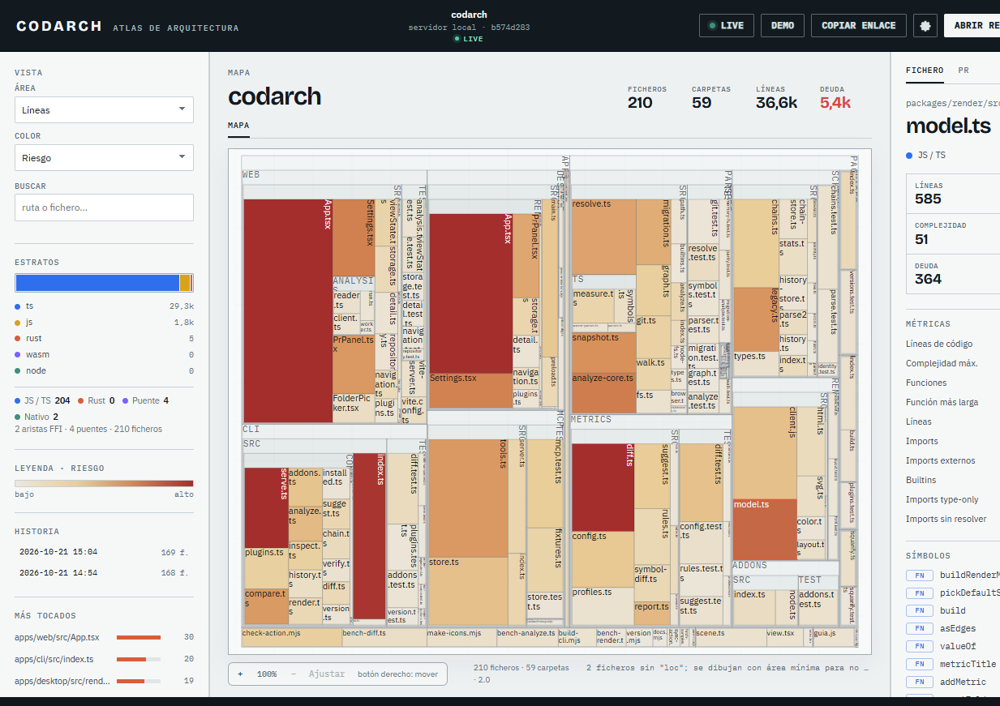
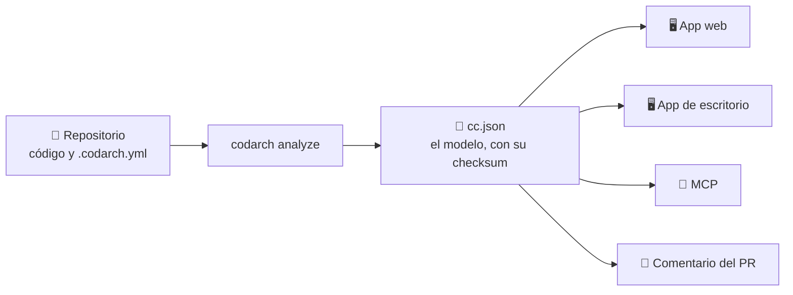

# CodArch

> Visual CodArch — un mapa vivo de la arquitectura de tu software: en el pull request, en el CI y
> en tu agente.

> [!IMPORTANT]
> **🧪 Alpha.** La funcionalidad está ✓; el producto todavía no ✓. Las versiones llevan prerelease ✓
> (`0.3.1-alpha.3` ✓), el CLI ✓ y las apps ✓ pueden cambiar ✓ de una versión a otra ✓, y **no hay
> soporte** ✓. Úsalo si te sirve **mirar** ✓ —un mapa ✓, un diff ✓, un comentario de PR ✓—; no si
> necesitas que no se rompa ✓. Lo que **sí** es estable ✓: el modelo `cc.json` 2.x ✓ y su checksum ✓.

**Qué hay hoy:** el CLI `codarch` ✓ (publicado en npm ✓), la GitHub Action pública ✓
(`jaminsmoke/codarch/apps/github-action@v1` ✓, que funciona desde otros repositorios ✓), el MCP de solo lectura
✓, la app web ✓ y la app de escritorio ✓. La lente de migración ✓ mide lenguajes ✓, puentes ✓ y
deuda ✓; el diff habla **símbolo a símbolo** ✓ y su cadena sobrevive a los renombrados ✓; la web
analiza una carpeta **en el navegador** ✓ con el mismo checksum ✓ que el CLI ✓; los plugins ✓ y los
addons ✓ extienden el producto ✓, y los ajustes ✓ traen la sección de actualizaciones ✓.



*CodArch analizando su propio repo: 210 ficheros ✓, 59 carpetas ✓, el riesgo por bloque ✓ y el
inspector con los símbolos del fichero ✓.*



El mismo `cc.json` alimenta todas las salidas: el checksum no depende de quién mira.

La web del proyecto está en **[`jaminsmoke.github.io/codarch`](https://jaminsmoke.github.io/codarch)**
✅: la portada ✅, los documentos ✅ y la guía ✅ ✅.

Las decisiones están registradas en [`apps/site/docs/adr/`](apps/site/docs/adr/) —cada una con su **hoja de ruta** dentro
y el registro en la guía—, el modelo en [`apps/site/docs/model.md`](apps/site/docs/model.md), el diseño del mapa en
[`apps/site/docs/design/map.md`](apps/site/docs/design/map.md), el MCP en [`apps/site/docs/mcp.md`](apps/site/docs/mcp.md), la migración en
[`apps/site/docs/migration.md`](apps/site/docs/migration.md), el índice de fases en
[`apps/site/docs/adr/roadmap.md`](apps/site/docs/adr/roadmap.md) y las ideas que faltan en
[`la guía`](apps/site/docs/guideline/).

## 🧭 Dónde está cada pieza

| Pieza | Canal | Cómo se usa |
|---|---|---|
| **CLI** | [npm `codarch`](https://www.npmjs.com/package/codarch) | `npm install -g codarch@next` |
| **Web del proyecto** | [GitHub Pages](https://jaminsmoke.github.io/codarch) | se publica sola con cada cambio de `main` |
| **App web del mapa** | dentro del CLI | `codarch serve .` |
| **App web en Docker** | GHCR | `docker compose up --build` |
| **Escritorio** | [Releases del repo](https://github.com/jaminsmoke/codarch/releases) | instaladores Windows/Linux sin firmar |
| **GitHub Action** | [`jaminsmoke/codarch/apps/github-action@v1`](https://github.com/jaminsmoke/codarch/tree/main/apps/github-action) | `uses: jaminsmoke/codarch/apps/github-action@v1` |

El CLI se publica en **npmjs**, no en GitHub Packages. La web del proyecto es un **deployment** de
Pages, no un release. La app web del mapa viaja dentro del CLI: su versión es la del CLI; la imagen
de Docker es otra forma de instalar esa misma app. El único release con instaladores es el del
escritorio.

---

## 🚀 Quickstart

```bash
npm install
npm run samples                 # descarga dos cc.json reales de CodeCharta (1,3 MB)

# Analizar un proyecto TypeScript/JavaScript
npm run analyze -- .
npm run analyze -- . -o .codarch --title "Mi proyecto"
npm run analyze -- . --no-git      # sin historial de git

# Inspeccionar y renderizar un cc.json existente
npm run inspect -- samples/codecharta_visualization.cc.json.gz
npm run render -- samples/codecharta_visualization.cc.json.gz -o samples/map.html

# Comparar dos snapshots (por ejemplo, base y head de un PR)
npm run diff -- base.cc.json head.cc.json -o report.json
npm run diff -- base.cc.json head.cc.json --fail-on violations

# Servidor MCP para agentes (solo lectura, stdio)
npm run analyze -- .
npm run mcp -- --help
# configuración del cliente: apps/site/docs/mcp.md

# Lente de migración: deuda y frontera FFI
npm run inspect -- .codarch/snapshot.cc.json --metric migrationDebt --top 10
npm run render -- .codarch/snapshot.cc.json --area rloc --color migrationDebt -o .codarch/migration.html

# App web (M5): arranca también el servidor de datos y lo para al cerrar Vite
npm run web:dev
npm run web:build

# Visor local: analiza el repo, sirve la web y reanaliza al guardar
npm run serve -- .

# Política de arquitectura opcional
cp .codarch.example.yml .codarch.yml

npm run bench:render            # 5.000 ficheros sintéticos
npm run bench:analyze           # 2.000 ficheros sintéticos
npm run bench:diff              # diff de 2.000 → 2.010 ficheros
npm run check:action            # valida action.yml, workflow y comentario
npm test

# Distribución del CLI: build y tarball local; publicar requiere npm login
npm run build:cli
npm run pack:cli
npm run publish:cli
```

### La app web con Docker

Si no quieres instalar Node, la app web se puede abrir desde un contenedor local:

```bash
docker compose up --build
# abre http://127.0.0.1:4173
```

El repositorio actual se monta en `/workspace` en solo lectura. Para mirar otro repo:

```bash
CODARCH_REPO=/ruta/al/repo docker compose up --build
```

La imagen publicada es `ghcr.io/jaminsmoke/codarch-web:latest`; también se puede construir
desde el repo con `docker build -t codarch-web .`. El contenedor no es un backend remoto: escucha
solo en loopback y analiza el árbol montado (ADR 0044).

`codarch analyze` escribe dos artefactos:

```
.codarch/
├── snapshot.cc.json   # cc.json 2.0 determinista
└── map.html           # treemap 2D autocontenido
```

El snapshot incluye el árbol de ficheros/carpetas, 15 métricas de código y grafo, 2 métricas de
historial cuando hay git (`number_of_commits`, `number_of_authors`), aristas internas con peso y
type-only, y niveles de dependencia. El checksum es MD5 de una serialización canónica de
`{ files, lenses }`: no incluye timestamps ni rutas absolutas.

Salida de `analyze` sobre el fixture de test con `--no-git`:

```
  CodArch · análisis

  raíz         ...\packages\parsers\test\fixtures\repo
  snapshot     .codarch/fixture/snapshot.cc.json (17 KB)
  mapa         .codarch/fixture/map.html (49 KB)
  estructura   15 ficheros · 7 carpetas · 13 aristas · 2 ciclos
  imports      2 externos · 0 builtins · 1 type-only · 2 sin resolver
  tiempo       30 ms
  historial    sin git; se omite churn
```

El render produce un HTML único, sin servidor ni red, con treemap, búsqueda, inspector, dependencias
entrantes/salientes y tres lentes: estructura, riesgo y métrica. El riesgo se calcula en
`packages/metrics` y lo comparten el render y el MCP; no se almacena en el snapshot. Si falta
churn o complejidad, los pesos se renormalizan.

### 📜 La historia del repositorio

`codarch analyze --history` guarda la foto en `.codarch-history/`, en la raíz del repo, y
`codarch history` lista la línea del tiempo:

```
.codarch-history/
├── index.json                      # la línea del tiempo: fecha, checksum, recuentos
└── 2026-10-21T14-54-09-296-0dca58ac.cc.json
```

El historial vive **fuera** de `.codarch/` a propósito: ahí están los artefactos locales (ignorados
por git) y la historia es justo lo que un equipo quiere compartir. El snapshot sigue siendo
determinista: la fecha va en el índice, nunca dentro del snapshot.

La lente de calor (cuántos commits ha tenido cada fichero) sale del churn que ya se analiza, así que no
cuesta nada: el mapa la puede colorear y el panel lateral lista los ficheros más tocados.

Para comparar dos momentos:

```bash
codarch history --from 0dca58ac --to b9bf7414 -o report.json
```

Es el mismo motor que `codarch diff`, pero entre dos fotos de la línea del tiempo. La web y el
escritorio enseñan la línea del tiempo y abren cualquier foto.
([ADR 0024](apps/site/docs/adr/0021-0030/0024-evolucion-temporal.md))

### 🔀 Diff entre commits

`codarch diff` compara dos snapshots ya generados, sin volver a analizar el código:

```
$ codarch diff base.cc.json head.cc.json -o report.json

  CodArch · diff

  base         base.cc.json (a45c1ca5…)
  head         head.cc.json (39855f12…)
  ficheros     +4 · -1 · ~3
  aristas      +6 · -2 · 1 cíclicas nuevas
  ciclos       +1 nuevos · 0 resueltos
  hotspots     2 (maxComplexity)
  reporte      report.json (12 KB)

  Ciclos nuevos:
    ✗ src/domain/service.ts → src/infra/db.ts → src/domain/service.ts

  Hotspots (maxComplexity):
    ● src/payments/service.ts  18 → 59 (+41)
```

El reporte separa `files.added/removed/changed`, `edges.added/removed/cyclicAdded/cyclicRemoved`,
`cycles.introduced/fixed` y `hotspots`. Es determinista y no guarda timestamps. Los cambios de
métricas usan `delta: null` cuando una métrica solo existe en un lado; no se inventan ceros. La
decisión está en [ADR 0010](apps/site/docs/adr/0001-0010/0010-diff-entre-snapshots.md). El bloque `rules` separa
violaciones `introduced`, `existing` y `resolved`; ver [ADR 0011](apps/site/docs/adr/0011-0020/0011-reglas-de-arquitectura.md).

`--fail-on cycles|violations|hotspots|any` convierte el diff en gate de CI: devuelve `2` si hay
hallazgos, `1` si hay un error de lectura. Sin `--fail-on`, devuelve `0`.

### 🧱 Reglas de arquitectura

Si existe `.codarch.yml` en el cwd, el diff evalúa capas prohibidas, umbrales y ciclos. Solo las
violaciones **introducidas** con severidad `error` bloquean; la deuda previa se reporta pero no
congela el PR. Ejemplo:

```yaml
version: 1
layers:
  - name: domain
    paths: [src/domain/**]
  - name: infra
    paths: [src/infra/**]
rules:
  - name: domain-no-infra
    type: forbidden
    from: domain
    to: infra
    severity: error
  - name: complejidad
    type: threshold
    metric: maxComplexity
    max: 40
    severity: warn
```

La referencia completa está en [`apps/site/docs/rules.md`](apps/site/docs/rules.md) y la decisión en
[ADR 0011](apps/site/docs/adr/0011-0020/0011-reglas-de-arquitectura.md). `--no-config` desactiva las reglas.

#### Perfiles de arquitectura

En vez de escribir las capas y las reglas a mano, se puede elegir un **perfil** del catálogo:

```yaml
version: 1
profile: capas        # capas | hexagonal | onion | ddd
```

```bash
codarch profiles      # lista el catálogo con sus capas y sus reglas
```

Las reglas del perfil entran **como aviso**: consultan, no bloquean. Para endurecer una, se escribe
en el archivo del equipo con el mismo nombre y `severity: error`; el reporte dice de dónde sale cada
regla (`source: "config"` o `source: "profile"`). Decisión en
[ADR 0023](apps/site/docs/adr/0021-0030/0023-lente-de-dominio-por-pasos.md).

#### Generar las capas

Si el repo no encaja en ningún perfil, el generador deduce la estructura del propio código:

```bash
codarch suggest .codarch/snapshot.cc.json
```

Agrupar por carpeta, mirar el grafo y ordenar las capas de dentro afuera. Devuelve un fragmento
para `.codarch.yml` con las capas y las reglas que las protegerían, dice **qué perfil del catálogo
encaja** y avisa de las reglas que el código ya incumple. Propone, no decide.

### 💬 GitHub Action

La acción analiza el merge-base y el head de un PR, publica `snapshot.cc.json`, `map.html` y
`report.json` como artefacto, y actualiza un comentario con el diff. El mismo commit puede ejecutarse
en modo aviso (`fail-on: none`) o bloqueo (`fail-on: violations|cycles|hotspots|any`); la severidad
de cada regla se decide en `.codarch.yml`.

```yaml
permissions:
  contents: read
  pull-requests: write
steps:
  - uses: actions/checkout@v7
    with: { fetch-depth: 0 }
  - uses: jaminsmoke/codarch/apps/github-action@v1
    with:
      github-token: ${{ secrets.GITHUB_TOKEN }}
      fail-on: none
```

La acción instala `codarch` desde npm; no necesita el código de CodArch en el workspace ni ejecuta
`npm ci` sobre el proyecto analizado. Vive en `apps/github-action` del monorepo público. El workflow de ejemplo es
[`.github/workflows/codarch.yml`](.github/workflows/codarch.yml).

### 🤖 MCP para agentes

`apps/mcp` es un servidor MCP local por stdio que lee un snapshot y, si existe, un reporte. No
analiza código ni escribe nada: expone el mismo modelo que ven el mapa y el PR.

```bash
npm run analyze -- .
npm run mcp -- --help
```

Configuración genérica del cliente (sustituye la ruta por tu checkout):

```json
{
  "mcpServers": {
    "codarch": {
      "command": "node",
      "args": [
        "C:/ruta/repo/apps/mcp/bin/codarch-mcp.mjs",
        "--root", "C:/ruta/repo",
        "--snapshot", ".codarch/snapshot.cc.json",
        "--report", ".codarch/report.json"
      ]
    }
  }
}
```

Herramientas:

| Herramienta | Pregunta que responde |
|---|---|
| `get_architecture_map` | ¿Cómo se organiza el proyecto y qué pesa en cada carpeta? |
| `find_hotspots` | ¿Qué ficheros concentran riesgo o una métrica? |
| `check_change_impact` | ¿Qué depende de este fichero, directa o transitivamente? |
| `list_violations` | ¿Qué reglas se rompen y cuáles son nuevas? |
| `explain_module` | Dame métricas, aristas, ciclo, diff y violaciones de esta ruta. |
| `get_migration_plan` | ¿Cuánta deuda de migración queda, dónde y cómo ha cambiado? |
| `get_history` | ¿Cómo ha cambiado la arquitectura de este repo a lo largo del tiempo? |

Sin reporte, las consultas de cambios y violaciones devuelven `available: false` con un motivo. Las
rutas son relativas al proyecto; también se aceptan ids. Se rechazan rutas absolutas y `..`. Toda la
superficie es de solo lectura. Referencia completa en [`apps/site/docs/mcp.md`](apps/site/docs/mcp.md) y decisión en
[ADR 0013](apps/site/docs/adr/0011-0020/0013-mcp-readonly.md).

---

## 🔍 Qué analiza

### 📊 Ficheros y métricas

Recorre TS/TSX/JS/JSX (`.ts`, `.tsx`, `.mts`, `.cts`, `.js`, `.jsx`, `.mjs`, `.cjs`) respetando
`.gitignore` raíz y anidados, negaciones, `node_modules`, `.git` y `.codarch`.

Métricas de parser:

| Métrica | Significado |
|---|---|
| `loc` | Líneas físicas |
| `rloc` | Líneas con al menos un token de código |
| `functions` | Funciones, métodos, arrows y callbacks implementados (con o sin nombre) |
| `maxComplexity` | Complejidad ciclomática de la función más compleja (también las anónimas) |
| `maxFunctionLength` | Líneas de la función más larga |

Métricas de imports y grafo:

| Métrica | Significado |
|---|---|
| `imports` | Imports, reexports y requires declarados |
| `externalImports` | Paquetes fuera del proyecto, sin builtins |
| `builtinImports` | Módulos nativos de Node |
| `typeOnlyImports` | Imports que solo existen en tipos |
| `unresolvedImports` | Specifiers internos que no apuntan a un fichero analizado |
| `fanIn` / `fanOut` | Ficheros que importan / son importados |
| `inCycle` | Pertenece a un componente cíclico |
| `cycleSize` | Tamaño del componente cíclico |
| `dependencyLevel` | Profundidad en el DAG de componentes |

Métricas de historial (si hay git):

| Métrica | Significado |
|---|---|
| `number_of_commits` | Commits que tocaron el fichero |
| `number_of_authors` | Autores únicos de esos commits |

### 🧩 Símbolos

El mapa no solo sabe qué ficheros hay y cómo se llamaban entre sí: también sabe **qué hay dentro** de
cada uno. La lente `symbols` guarda las funciones, clases, interfaces, tipos y enums de cada fichero,
con su línea y, en las funciones, su complejidad ciclomática.

```bash
# La función más enrevesada del repo
codarch analyze . -o .codarch/verif
```

En la web y en el escritorio, el inspector lista los símbolos del fichero de la función más compleja
a la más simple. El agente pregunta lo mismo con `explain_module` y `get_architecture_map`.
([ADR 0025](apps/site/docs/adr/0021-0030/0025-lente-de-simbolos.md))

### 🔬 El diff, hasta el interior

El diff de CodArch no solo compara ficheros: compara **símbolos**. El reporte dice qué función
cambió y cómo cambió su complejidad, en vez de "has tocado tres ficheros":

```
  ficheros     +0 · -1 · ~1
  código       0 rloc añadidos · -6 · ~+8 en ficheros cambiados
  símbolos     +1 · -2 · ~1

  Símbolos que más cambiaron:
    · src/datos.ts  cargar (complejidad +2)
```

Lo mismo aparece en el comentario del PR y en el panel de PR de las dos apps.

### 🏷️ La identidad de un símbolo

Cada símbolo lleva el **hash de su cuerpo**: los tokens, sin comentarios y sin su propio nombre. Con
ese hash, un renombrado o una mudanza no rompen nada, porque lo que define al símbolo es el código,
no el sitio donde está. El hash es el mismo en el navegador y en el CLI ✓, así que el checksum del
snapshot no cambia.
([ADR 0026](apps/site/docs/adr/0021-0030/0026-la-vida-de-un-simbolo.md))

### 📝 Los nombres de los bloques

Cada bloque lleva su nombre **dentro** ✓ (`foreignObject` con texto HTML ✓): el navegador lo envuelve
✓ y lo recorta ✓, así que **no puede salirse** ✓. En bloques altos y estrechos escribe en vertical ✓
(`writing-mode` ✓), y el tamaño sale del lado corto del bloque ✓ (de 4 a 11 px ✓).

Es un interruptor en **Ajustes → Vista** ✓ y también viaja en el enlace ✓ (`labels=1` ✓). Con el
botón derecho apretado, el mapa se mueve ✓.

### 📐 El mapa se ajusta a la pantalla

La app ocupa la ventana ✓: el raíl y el inspector scrollean solos ✓ y el mapa se ajusta a lo que
queda ✓ (nada crece la página ✓). El mapa se acerca con `+` ✓, `−` ✓, `Ajustar` ✓ o la rueda ✓
— la distribución no se recalcula ✓, solo el rectángulo visible ✓, así que acercar es gratis ✓.

### 🧊 La vista 3D

El primer plugin ✓: el mapa en tres dimensiones ✓. Cada fichero es una caja ✓ —la base es su
rectángulo del treemap ✓ y la altura su riesgo ✓— y el color es el del mapa ✓. Se orbita con el
ratón ✓ y al pulsar una caja se selecciona el fichero ✓.

Va en **su propio chunk** ✓ (495 KB ✓), así que el bundle principal no crece ✓ y solo se descarga si
alguien abre la vista ✓. Necesita WebGL2 ✓: si no lo hay, el store lo dice ✓.

Su hoja de ruta propia (el octree ✓, el nivel de detalle ✓, las carpetas como contenedores ✓) está
en `plugins/vista-3d/ROADMAP.md` ✓.

### 🔌 Los plugins

Un plugin es una pieza **del repo** ✓, en `plugins/` ✓, que se activa desde los ajustes ✓ y que
puede añadir una vista al mapa central ✓.

```
plugins/vista-3d/
  plugin.json     ← el manifiesto: nombre, versión, qué aporta y qué necesita
  index.tsx       ← el punto de entrada
```

El repo declara cuáles están **compilados** (`.codarch.yml`: `plugins: [...]` ✓) y el usuario
activa cuáles quiere en **su máquina** ✓: el análisis no depende de eso ✓.

El contrato vive en `@codarch/plugin-api` ✓ y es pequeño a propósito ✓: el modelo ✓, la selección ✓,
las acciones ✓, las preferencias ✓ y el estado de la URL ✓.
([ADR 0028](apps/site/docs/adr/0021-0030/0028-los-plugins.md))

Un **addon** es otra cosa ✓ ([ADR 0029](apps/site/docs/adr/0021-0030/0029-los-addons.md) ✓): **datos, no código** ✓.
Aporta **conocimiento** ✓ — perfiles de arquitectura ✓, reglas ✓ y vistas guardadas ✓ — y vive en
`addons/<nombre>/` ✓, que viaja con el repo ✓: los compañeros y el CI ven lo mismo ✓. No puede
aportar lentes ✓, así que no cambia el checksum ✓.

El repo declara los que usa (`.codarch.yml`: `addons: [...]` ✓) y `codarch diff` aplica sus reglas
✓, cada una con su origen (`addon:nestjs` ✓) que se ve en el reporte ✓ y en el comentario del PR ✓.
Las dos apps y el MCP leen la configuración ✓: el menú **Vistas** del mapa aplica las **vistas
guardadas** del addon ✓ y el MCP las cuenta en `get_project_config` ✓.

### 📦 Instalar y quitar

Las dos extensiones se instalan y se quitan igual ✓
([ADR 0030](apps/site/docs/adr/0021-0030/0030-instalar-y-quitar.md) ✓): una carpeta hija ✓ y una línea en
`.codarch.yml` ✓, que es la lista de instalados ✓. Quitar borra **solo** la carpeta de esa
extensión ✓, nunca `plugins/` ni `addons/` ✓.

```bash
codarch plugins list            # los de plugins/ y cuáles declara el repo
codarch plugins add ./mi-vista  # copia la carpeta y la declara
codarch plugins remove mi-vista # la borra y quita la línea

codarch addons list
codarch addons add ./nestjs
codarch addons remove nestjs
```

Las dos listas avisan cuando el repo y la lista no cuadran ✓: una carpeta sin declarar ✓ (no entra
en el build ✓) y una declaración sin carpeta ✓. Con `--json` lo da para el CI ✓.

Instalar no es activar ✓: un plugin instalado se activa en los ajustes ✓, y un addon no se activa ✗
— se aplica mientras esté declarado ✓. La diferencia de fondo está en **dónde vive cada uno** ✓: un
plugin se instala en el build de CodArch ✓ (o en un fork ✓), no en el proyecto que analizas ✗; un
addon se instala en el proyecto ✓ y viaja con él ✓.

### ⚙️ Los ajustes

Hay un engranaje en la cabecera que abre los ajustes ✓: la métrica de área ✓, el modo de color ✓,
el proyecto guardado ✓, los plugins ✓, los addons del proyecto ✓ (en modo lectura ✓: son del repo,
no se activan) y el diagnóstico ✓ (versión ✓, checksum ✓, si el almacenamiento local está
disponible ✓). En el escritorio, también desde el menú nativo ✓.

Los ajustes son de la **máquina**, no del repositorio ✓: el análisis no cambia por tener el área en
otro sitio ✓.

### 🕰️ La vida de un símbolo

Cada símbolo lleva el hash de su cuerpo, así que un renombrado o una mudanza no lo rompen. Con el
historial, CodArch puede contar la vida de una función:

```bash
codarch chain buscar
```

    buscar  (function)
      src/otro.ts
      id 6b85c9abd2b8 · 4 versiones

      2026-10-21  nació         src/datos.ts
      2026-10-21  cambió        src/datos.ts
      2026-10-21  renombrada    src/datos.ts
        antes se llamaba cargar
      2026-10-21  mudada        src/otro.ts

El libro mayor (`.codarch/chains.json`) es un artefacto derivado: se regenera siempre desde las
fotos del historial. ([ADR 0026](apps/site/docs/adr/0021-0030/0026-la-vida-de-un-simbolo.md))

### 📅 Comprobar el historial

Las cadenas se anidan: la del fichero se compromete con las de sus símbolos, la de la carpeta con las
de sus hijos, y la del proyecto con todo el repo. Eso permite una comprobación global:

```bash
codarch verify
```

    CodArch · comprobación del historial

    ✅ Todo encaja: 1 símbolos cuadran con sus cadenas.
       Cabeza del proyecto: 7189039b399b13cf

Si alguien manipula un snapshot, el hash del cuerpo ya no es el de la cadena y se nota ✓.

### 🔥 El calor por símbolo

Un fichero con veinte funciones quietas y otro con una que se reescribe cada semana pesan igual en el
mapa. Con las cadenas, no: la barra lateral lista los **símbolos más reescritos** ✓, y el inspector
enseña la vida del que elijas ✓ (nació, se renombró, se mudó, cambió su complejidad ✓).

El agente pregunta lo mismo: `get_symbol_chain` ✓.

### 🔗 Resolución de imports

- Relativos (`./`, `../`) y absolutos desde el root.
- `.js`/`.jsx`/`.mjs`/`.cjs` → fuente TS equivalente.
- Directorios con `index.*`.
- `tsconfig.json`/`jsconfig.json`: `baseUrl`, `paths` y `extends`, usando el config más cercano.
- Workspaces de npm/pnpm/yarn: `exports`, `types`, `module`, `main` y fallback a `src/index.ts`.
- Builtins de Node (`node:fs`, `fs`, …) y paquetes externos se clasifican, pero no crean aristas.
- Imports internos que no resuelven se reportan y se excluyen del grafo. No se inventan aristas.

### 🕸️ Grafo

- Aristas deduplicadas por `(from, to)` con `weight` y `typeOnly`.
- Fan-in/fan-out sobre destinos únicos.
- Componentes fuertemente conexos (Kosaraju iterativo): ciclos de tamaño > 1 y self-loops.
- Niveles en el DAG condensado, de 0 (nadie lo importa) hacia sus dependencias.

### 🎯 Determinismo

Dos ejecuciones sobre el mismo commit producen el mismo snapshot y el mismo checksum. Los ficheros,
carpetas, aristas, componentes y claves de objetos se ordenan de forma estable. El checksum no cubre
`meta`, y no hay fecha, commit ni ruta absoluta en el payload.

El churn se lee de un único `git log --no-merges --numstat`, con todo el historial. No sigue renames
y no guarda fechas ni autores, solo conteos. Un clon shallow produce un warning porque los conteos
pueden estar incompletos. Ver [ADR 0009](apps/site/docs/adr/0001-0010/0009-churn-desde-git.md).

---

## ❓ El problema

Las métricas de código se miran en dashboards que nadie abre. La arquitectura se discute en
pizarras que caducan. Y cuando un cambio rompe una capa, se descubre en revisión — o en producción.

CodeCharta demostró que un mapa visual del código funciona. Pero un mapa que hay que abrir es un
mapa que se consulta poco. Nosotros queremos el mismo mapa **donde se toma la decisión**: en el diff
del PR, en el pipeline y en la conversación con un agente.

## 🧭 La cuña

Un **modelo de arquitectura headless** que alimenta tres consumidores:

```
$ codarch analyze . --base origin/main --head HEAD

  ✓ 4.812 ficheros · 1.9 s · 38 MB
  ✗ 2 ciclos nuevos        src/domain → src/infra → src/domain
  ✗ 1 capa violada         ui/Checkout.tsx importa db/queries.ts
  ● 3 hotspots movidos     payments/service.ts  +41 complejidad
  → mapa: .codarch/index.html   reporte: .codarch/report.json
```

1. **CLI + mapa estático** — el artefacto que se ve y se comparte.
2. **Bot de PR** — el mismo análisis, convertido en comentario y en gate.
3. **Servidor MCP** — el mismo modelo, consultable por agentes.

## 💡 Principios

1. **El modelo es el producto.** Render, CLI y MCP son consumidores. Si el modelo está bien, los
   demás son baratos.
2. **Snapshots inmutables y deterministas.** Mismo repo + mismo commit = mismo hash. Sin esto no
   hay diff fiable, ni caché, ni CI.
3. **Grafo primero.** La jerarquía de ficheros es una proyección, no la verdad.
4. **Compatible con `cc.json` 2.x.** Entrada garantizada; 1.x se normaliza al leer.
5. **Cero configuración para empezar.** Reglas y umbrales cuando duelan, no antes.
6. **Núcleo headless.** Los `packages/` no saben qué es un componente; las `apps/` no tienen
   lógica de dominio.
7. **Incremental por defecto.** Ningún paso deja el producto roto. Cada milestone se puede usar,
   medir y comparar con el anterior.

## 🚫 No objetivos de la v1

Plugins · cloud · auth · multi-repo · 3D · importación de Sonar · más de un lenguaje.

Si algo de esto entra, el MVP se convierte en CodeCharta 2 y perdemos la cuña.

## 🏆 Criterios de éxito

| Criterio | Objetivo | Estado |
|---|---|---|
| Repo de 2k ficheros | analizado en < 3 s | 2,6 s (sintético, 2.000 ficheros) |
| Memoria de analyze | < 500 MB | 311 MB RSS (sintético) |
| Salida | determinista (mismo hash) | test de dos ejecuciones, también con churn |
| Diff | reporte estable, sin reanálisis | ~9 ms para 2.000 → 2.010 ficheros (sintético) |
| Reglas | solo bloquea lo introducido | `introduced` / `existing` / `resolved` en el reporte |
| MCP | consultas de solo lectura, sin análisis oculto | 6 herramientas, 29 tests y smoke stdio |
| Configuración | cero para el primer resultado | `codarch analyze .` |
| Comentario de PR | < 10 s de extremo a extremo | acción repo-local validada; falta medir en runner |
| Legibilidad | el mapa se entiende en una captura | verificado en M0 |

## 🏗️ Estructura

```
packages/   schema · parsers · metrics · layouts · render
apps/       cli · mcp · github-action · web (M5)
apps/site/docs/       adr/ (decisiones, en carpetas de diez; roadmap.md dentro) · design/ · model.md · rules.md · mcp.md · guideline/
scripts/    bench-*.ts · build-cli.mjs · pack-cli.mjs · sync-action.mjs · check-action.mjs · fetch-samples.mjs
design/     prototipo navegable del mapa 2D
```

Implementado: `schema`, `parsers`, `metrics`, `layouts`, `render` y los comandos `codarch analyze`,
`codarch inspect`, `codarch render` y `codarch diff`. `parsers` incluye parser tree-sitter, walker con
`.gitignore`, resolver de imports, grafo, churn de git y construcción del snapshot; `metrics` calcula
el diff determinista, las reglas, el riesgo compartido y la GitHub Action; `parsers` también mide
Rust y la frontera FFI para la lente de migración; `apps/mcp` expone el modelo a agentes por stdio;
`apps/web` es el visor interactivo que reutiliza `buildRenderModel` y `layoutMap`.

## 🎨 Inspiración

[CodeCharta](https://github.com/MaibornWolff/codecharta) (BSD-3-Clause, MaibornWolff). Proyecto
independiente, sin código derivado. Ver [ADR 0001](apps/site/docs/adr/0001-0010/0001-clean-room-con-ccjson.md).

## 🔒 Privacidad

CodArch **no recoge nada** ✓: el análisis ✓, los snapshots ✓, los reportes ✓ y el historial ✓ se
quedan en tu disco ✓, y nada se manda a ningún sitio ✓. Lo único que sale a la red ✓ es la
comprobación de actualizaciones ✓ —a npm ✓ y a GitHub ✓— y solo cuando tú la pides ✓ (el botón
**Comprobar ahora** ✓ de los ajustes ✓).

El código manda su telemetría ✓ a ningún sitio ✓ porque no tiene dónde mandarla ✓.

## 📄 Los papeles del repo

| Fichero | Qué es |
|---|---|
| [`LICENSE`](LICENSE) | MIT ✓: el código ✓ es libre ✓ |
| [`TRADEMARK.md`](TRADEMARK.md) | el nombre ✓ y el logotipo ✓ **no** se conceden ✓ |
| [`NOTICE.md`](NOTICE.md) | los créditos ✓: CodeCharta ✓, tree-sitter ✓, las tipografías ✓ |
| [`SECURITY.md`](SECURITY.md) | cómo se avisa de un fallo de seguridad ✓ |
| [`CONTRIBUTING.md`](CONTRIBUTING.md) | cómo se contribuye ✓ |
| [`AGENTS.md`](AGENTS.md) | las reglas del repo ✓ |
