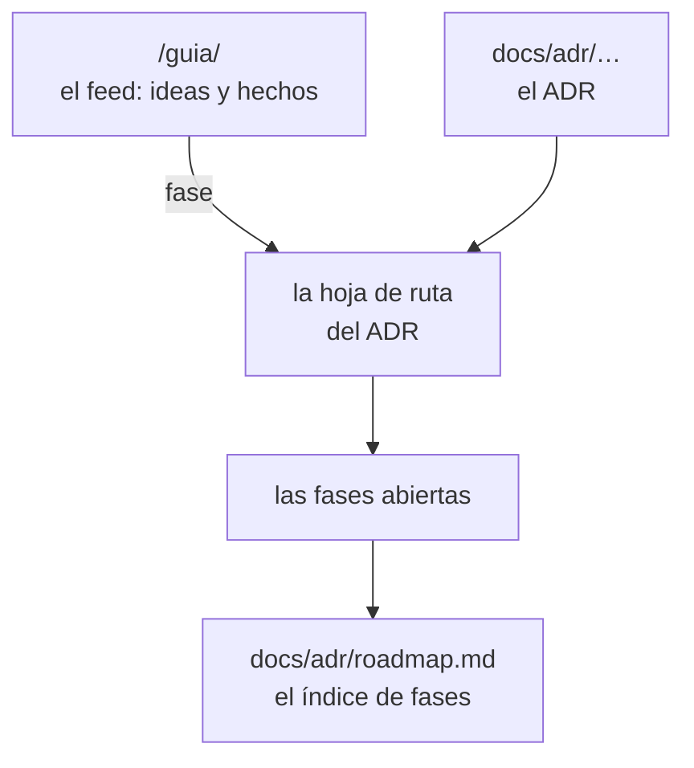

Cada decisión tiene su ADR con su **hoja de ruta** dentro (`## Hoja de ruta`). El **registro** de lo
hecho y lo que llega vive en el [feed de la guía](/guia/). Este es el índice: número, título, fecha,
estado y fases.

| ADR | Decisión | Fecha | Estado | Fases |
|---|---|---|---|---|
| [0001](0001-0010/0001-clean-room-con-ccjson.md) | Clean-room, con `cc.json` como frontera | 2026-10-20 | aceptado | se aplica en M0 |
| [0002](0001-0010/0002-monorepo-core-first.md) | Monorepo core-first | 2026-10-20 | aceptado | se aplica en M0, M1 |
| [0003](0001-0010/0003-typescript-first.md) | TypeScript primero, Rust cuando un benchmark lo exija | 2026-10-20 | aceptado | M1 |
| [0004](0001-0010/0004-cuna-pr-ci-mcp.md) | La cuña: PR/CI + MCP | 2026-10-20 | aceptado | se aplica en M2, M3 |
| [0005](0001-0010/0005-2d-first.md) | 2D primero, 3D como lente | 2026-10-20 | aceptado | M0 |
| [0006](0001-0010/0006-nodos-fichero.md) | Nodos = ficheros, preparados para símbolos | 2026-10-20 | aceptado | se aplica en M0 |
| [0007](0001-0010/0007-nombre-codarch.md) | El nombre: CodArch | 2026-10-20 | aceptado | se aplica en M0 |
| [0008](0001-0010/0008-diseno-mapa-2d.md) | Diseño del mapa 2D | 2026-10-20 | aceptado | M5, M5.1 |
| [0009](0001-0010/0009-churn-desde-git.md) | Churn desde git, sin romper el determinismo | 2026-10-20 | aceptado | se aplica en M2 |
| [0010](0001-0010/0010-diff-entre-snapshots.md) | Diff entre snapshots y reporte estable | 2026-10-20 | aceptado | M2 |
| [0011](0011-0020/0011-reglas-de-arquitectura.md) | Reglas de arquitectura en `.codarch.yml` | 2026-10-20 | aceptado | se aplica en M2, M9 |
| [0012](0011-0020/0012-github-action.md) | GitHub Action para PRs | 2026-10-20 | aceptado | se aplica en M2 |
| [0013](0011-0020/0013-mcp-readonly.md) | Servidor MCP de solo lectura | 2026-10-20 | aceptado | se aplica en M3 |
| [0014](0011-0020/0014-distribucion-cli-npm.md) | Distribución del CLI como paquete npm único | 2026-10-20 | aceptado | M3 |
| [0015](0011-0020/0015-accion-publica-separada.md) | Acción pública separada | 2026-10-20 | aceptado | se aplica en M3 |
| [0016](0011-0020/0016-lente-migracion.md) | Lente de migración v1 | 2026-10-20 | aceptado | M4 |
| [0017](0011-0020/0017-servidor-local.md) | Servidor local `codarch serve` | 2026-10-20 | aceptado | se aplica en M5, M5.1 |
| [0018](0011-0020/0018-estado-vista-en-la-url.md) | Estado de vista en la URL y carga por URL | 2026-10-21 | aceptado | se aplica en M5, M5.1 |
| [0019](0011-0020/0019-nivel-de-detalle-del-mapa.md) | Nivel de detalle del mapa | 2026-10-21 | aceptado | se aplica en M5, M5.1 |
| [0020](0011-0020/0020-analisis-en-el-navegador.md) | Análisis en el navegador con la misma gramática que el CLI | 2026-10-21 | aceptado | M6 |
| [0021](0021-0030/0021-app-de-escritorio.md) | App de escritorio (Electron) con su propia interfaz | 2026-10-21 | aceptado | M7 · UI compartida en 0043 |
| [0022](0021-0030/0022-la-migracion-donde-faltaba.md) | La migración, donde ya faltaba | 2026-10-21 | aceptado | M8 |
| [0023](0021-0030/0023-lente-de-dominio-por-pasos.md) | Lente de dominio, por pasos | 2026-10-21 | aceptado | M9 |
| [0024](0021-0030/0024-evolucion-temporal.md) | La evolución temporal: el calor y la historia | 2026-10-21 | aceptado | M10 |
| [0025](0021-0030/0025-lente-de-simbolos.md) | La lente de símbolos: mirar dentro del fichero | 2026-10-21 | aceptado | M11 |
| [0026](0021-0030/0026-la-vida-de-un-simbolo.md) | La vida de un símbolo: la cadena que sobrevive al renombrado | 2026-10-21 | aceptado | M12 |
| [0027](0021-0030/0027-los-ajustes.md) | Los ajustes: un sitio donde se configura todo | 2026-10-21 | aceptado | M13 |
| [0028](0021-0030/0028-los-plugins.md) | Los plugins: piezas del repo que se activan | 2026-10-21 | aceptado | M14, M15 |
| [0029](0021-0030/0029-los-addons.md) | Los addons: conocimiento declarativo | 2026-10-22 | aceptado | M16 |
| [0030](0021-0030/0030-instalar-y-quitar.md) | Instalar y quitar: plugins y addons | 2026-10-22 | aceptado | M17 |
| [0031](0031-0040/0031-los-documentos.md) | Los documentos: cada decisión con su hoja de ruta | 2026-10-22 | aceptado | M18, M19, M20 |
| [0032](0031-0040/0032-las-versiones-y-las-actualizaciones.md) | Las versiones y las actualizaciones | 2026-10-22 | aceptado | M21 |
| [0033](0031-0040/0033-abrir-el-repo.md) | Abrir el repo: lo que hay que tener antes | 2026-10-22 | aceptado | M22 |
| [0034](0031-0040/0034-la-web-del-proyecto.md) | La web del proyecto | 2026-10-22 | aceptado | M23 |
| [0035](0031-0040/0035-la-guia-como-changelog.md) | La guía se lee como un changelog | 2026-10-22 | aceptado | M23.6–M23.9 |
| [0036](0031-0040/0036-el-roadmap-en-el-adr-y-el-changelog.md) | El roadmap vive en el ADR y el changelog al lado | 2026-10-22 | aceptado · 0047 | M23, M24 |
| [0037](0031-0040/0037-los-ciclos-de-ejecucion.md) | Los ciclos: de ejecución, no de tipos | 2026-10-23 | aceptado | se aplica en M2, M9 |
| [0038](0031-0040/0038-el-alcance-del-analisis.md) | El alcance del análisis se declara en `.codarch.yml` | 2026-10-23 | aceptado | se aplica en M2, M5 |
| [0039](0031-0040/0039-la-busqueda-de-una-cadena.md) | La búsqueda de una cadena: símbolos, no nodos | 2026-10-23 | aceptado | se aplica en M12 |
| [0040](0031-0040/0040-la-complejidad-del-cuerpo-entero.md) | La complejidad cuenta el cuerpo entero | 2026-10-23 | aceptado | se aplica en M0, M11 |
| [0041](0041-0050/0041-cada-version-una-vez.md) | Cada versión se declara una vez | 2026-10-23 | aceptado | se aplica en todo el repo |
| [0042](0041-0050/0042-la-entrega-se-automatiza.md) | La entrega se automatiza | 2026-10-23 | aceptado | M25 |
| [0043](0041-0050/0043-la-ui-compartida.md) | La UI se comparte por paquete | 2026-10-23 | aceptado | M26 |
| [0044](0041-0050/0044-la-web-en-docker.md) | La app web en un contenedor local | 2026-10-23 | aceptado | M27 |
| [0045](0041-0050/0045-el-escritorio-se-instala-y-se-actualiza.md) | El escritorio se instala y se actualiza mejor | 2026-10-23 | aceptado | M28 |
| [0046](0041-0050/0046-los-documentos-con-starlight.md) | Los documentos se publican con Starlight | 2026-10-23 | aceptado | M29 |
| [0047](0041-0050/0047-el-changelog-es-la-guia.md) | El changelog es la guía | 2026-10-23 | aceptado | M30 |
| [0048](0041-0050/0048-el-escritorio-persiste-en-codarch.md) | El escritorio persiste en `.codarch/` del repo | 2026-10-24 | aceptado | M32 |
| [0049](0041-0050/0049-la-orquestacion-se-comparte.md) | La orquestación se comparte, la plataforma se adapta | 2026-10-24 | aceptado | M33 |
| [0050](0041-0050/0050-el-repositorio-guarda-su-estado.md) | El repositorio guarda su estado | 2026-10-24 | aceptado | M34 |
| [0051](0051-0060/0051-la-version-se-sube-con-un-comando.md) | La versión se sube con un comando | 2026-10-24 | aceptado | se aplica en cada release |
| [0052](0051-0060/0052-solo-hacia-abajo-y-nunca-el-sistema.md) | Solo hacia abajo y nunca el sistema | 2026-10-24 | aceptado | se aplica en el análisis |
| [0053](0051-0060/0053-la-configuracion-no-se-mezcla.md) | La configuración de la app no se mezcla con la del repo | 2026-10-24 | aceptado | se aplica en la entrega |
| [0054](0051-0060/0054-el-lint-por-app.md) | El lint, por app y por tipo de código | 2026-10-24 | aceptado | M35 |
| [0055](0051-0060/0055-el-3d-se-dibuja-con-webgl2.md) | El 3D se dibuja con WebGL2 propio | 2026-10-24 | aceptado | M15 |
| [0056](0051-0060/0056-el-live-no-repite-el-analisis.md) | El live no repite el análisis | 2026-10-24 | aceptado | M36 |
| [0057](0051-0060/0057-la-ficha-del-fichero-habla-de-sus-lentes.md) | La ficha del fichero habla de sus lentes | 2026-10-25 | aceptado | M37 |
| [0058](0051-0060/0058-las-reglas-tienen-su-pestana.md) | Las reglas tienen su pestaña | 2026-10-25 | aceptado | M38 |
| [0059](0051-0060/0059-tres-pestanas.md) | Tres pestañas y adiós al nombre PR | 2026-10-25 | aceptado | M39 |
| [0060](0051-0060/0060-la-ficha-se-lee-en-una-tabla.md) | La ficha del fichero se lee en una tabla | 2026-10-25 | aceptado | M40 |
| [0061](0061-0070/0061-el-marco-del-proyecto.md) | El proyecto vive en la cabecera y las secciones se pliegan | 2026-10-25 | aceptado | M41 |
| [0062](0061-0070/0062-los-simbolos-tambien-se-pliegan.md) | Los símbolos también se pliegan | 2026-10-25 | aceptado | M42 |
| [0063](0061-0070/0063-todos-los-simbolos.md) | Todos los símbolos del módulo | 2026-10-25 | aceptado | M43 |
| [0064](0061-0070/0064-la-ficha-no-esconde-nada.md) | La ficha no esconde nada | 2026-10-25 | aceptado | M44 |
| [0065](0061-0070/0065-cada-componente-su-version.md) | Cada componente lleva su versión | 2026-10-25 | aceptado | M45 |
| [0066](0061-0070/0066-la-accion-vuelve-al-monorepo.md) | La acción vuelve al monorepo | 2026-10-25 | aceptado | M46 |
| [0067](0061-0070/0067-la-ficha-ensena-el-codigo.md) | La ficha enseña el código del símbolo | 2026-10-25 | aceptado | M47 |
| [0068](0061-0070/0068-la-ficha-abre-el-editor-y-sus-dependencias.md) | La ficha abre el editor y sus dependencias | 2026-10-25 | aceptado | M48 |
| [0069](0061-0070/0069-dos-pestanas.md) | Dos pestañas: el fichero y el cambio | 2026-10-25 | aceptado | M50 |
| [0070](0061-0070/0070-los-ficheros-del-cambio-en-una-lista.md) | Los ficheros del cambio, en una sola lista | 2026-10-25 | aceptado | M51 |
| [0071](0061-0070/0071-la-tabla-de-cambios-va-de-base-a-head.md) | La tabla de Cambios va de base a head | 2026-10-25 | aceptado | M52 |
| [0072](0071-0080/0072-cambios-desde-el-ultimo-commit.md) | Cambios desde el último commit | 2026-10-25 | aceptado | M53 |
| [0073](0071-0080/0073-una-sola-interfaz.md) | Una sola interfaz | 2026-10-26 | aceptado | M54 |
| [0074](0071-0080/0074-una-sola-sesion.md) | Una sola sesión de análisis | 2026-10-26 | aceptado | M55 |

## Las carpetas

Van por bloques de diez: el número ya dice cuándo se decidió y el tema lo dice el título.

- **0001-0010**: 0001, 0002, 0003, 0004, 0005, 0006, 0007, 0008, 0009, 0010
- **0011-0020**: 0011, 0012, 0013, 0014, 0015, 0016, 0017, 0018, 0019, 0020
- **0021-0030**: 0021, 0022, 0023, 0024, 0025, 0026, 0027, 0028, 0029, 0030
- **0031-0040**: 0031, 0032, 0033, 0034, 0035, 0036, 0037, 0038, 0039, 0040
- **0041-0050**: 0041, 0042, 0043, 0044, 0045, 0046, 0047, 0048, 0049
- **0051-0060**: 0051, 0052, 0053, 0054, 0055, 0056, 0057, 0058, 0059, 0060
- **0061-0070**: 0061, 0062, 0063, 0064, 0065, 0066, 0067, 0068, 0069, 0070, 0071
- **0071-0080**: 0072, 0073, 0074

El **roadmap** completo, con una línea por fase, está en [`roadmap.md`](roadmap.md).
