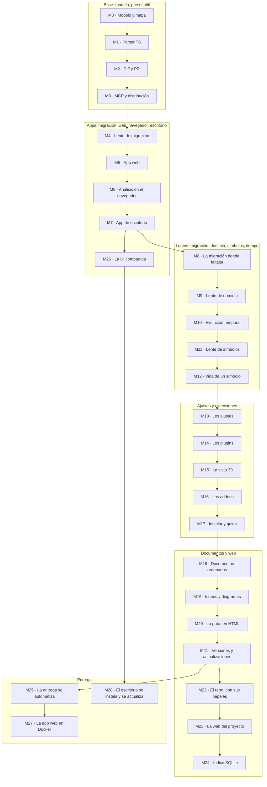

Cada milestone deja el producto funcionando y verificable. Nada de big-bang.

## Estado

Hoy CodArch tiene:

- **CLI** (`codarch`): `analyze`, `diff`, `render`, `inspect` y `serve`. Publicado en npm.
- **Modelo** `cc.json` 2.x: árbol de ficheros, métricas, grafo de dependencias, ciclos, lente de
  migración y checksum determinista. Es la verdad del producto y la comparten todas las apps.
- **Reglas** de arquitectura en `.codarch.yml`: capas, prohibiciones, umbrales y ciclos, con severidad
  y política de bloqueo.
- **MCP** de solo lectura: nueve consultas para agentes.
- **GitHub Action**: analiza base y head del PR, comenta el resultado y bloquea si la política falla.
- **App web**: mapa, inspector, vista de PR, nivel de detalle para repos grandes y análisis de una
  carpeta en el navegador con el mismo checksum que el CLI.
- **App de escritorio**: Electron con su propia interfaz, análisis nativo con git, menú del sistema
  e instaladores sin firmar.

Las fases M0-M22 están cerradas. M23 está en curso, M24 sin empezar, M25 cerrada, M26 cerrada,
M27 cerrada, M28 cerrada, M29 cerrada, M30 cerrada, M31 en curso, M32 cerrada, M33 cerrada, M34 en
curso y M35 en curso.

## Las fases

Cada fase vive en la **hoja de ruta de la decisión que la trae**: el ADR tiene un `## Hoja de ruta`
con lo abierto y lo que está en curso. Aquí solo está el **índice**; el detalle de lo hecho vive en
el **feed de la guía** ([`/guia/`](/guia/)). Si una fase crece, crece en su ADR, no aquí.

| Fase | Qué | Estado | Decisión |
|---|---|---|---|
| M0 | Modelo y mapa, sin parsers | cerrada | [ADR 0005](0001-0010/0005-2d-first.md) |
| M1 | Parser propio de TypeScript | cerrada | [ADR 0003](0001-0010/0003-typescript-first.md) |
| M2 | Diff y PR | cerrada | [ADR 0010](0001-0010/0010-diff-entre-snapshots.md) |
| M3 | MCP y distribución | cerrada | [ADR 0014](0011-0020/0014-distribucion-cli-npm.md) |
| M4 | Lente de migración | cerrada | [ADR 0016](0011-0020/0016-lente-migracion.md) |
| M5 | App web | cerrada | [ADR 0008](0001-0010/0008-diseno-mapa-2d.md) |
| M5.1 | Básicos de uso | cerrada | [ADR 0008](0001-0010/0008-diseno-mapa-2d.md) |
| M6 | Análisis en el navegador | cerrada | [ADR 0020](0011-0020/0020-analisis-en-el-navegador.md) |
| M7 | App de escritorio | cerrada | [ADR 0021](0021-0030/0021-app-de-escritorio.md) |
| M8 | La migración, donde ya faltaba | cerrada | [ADR 0022](0021-0030/0022-la-migracion-donde-faltaba.md) |
| M9 | Lente de dominio, por pasos | cerrada | [ADR 0023](0021-0030/0023-lente-de-dominio-por-pasos.md) |
| M10 | La evolución temporal | cerrada | [ADR 0024](0021-0030/0024-evolucion-temporal.md) |
| M11 | La lente de símbolos | cerrada | [ADR 0025](0021-0030/0025-lente-de-simbolos.md) |
| M12 | La vida de un símbolo | cerrada | [ADR 0026](0021-0030/0026-la-vida-de-un-simbolo.md) |
| M13 | Los ajustes | cerrada | [ADR 0027](0021-0030/0027-los-ajustes.md) |
| M14 | Los plugins | cerrada | [ADR 0028](0021-0030/0028-los-plugins.md) |
| M15 | La vista 3D | cerrada | [ADR 0028](0021-0030/0028-los-plugins.md) |
| M16 | Los addons | cerrada | [ADR 0029](0021-0030/0029-los-addons.md) |
| M17 | Instalar y quitar plugins y addons | cerrada | [ADR 0030](0021-0030/0030-instalar-y-quitar.md) |
| M18 | Los documentos ordenados | cerrada | [ADR 0031](0031-0040/0031-los-documentos.md) |
| M19 | Los documentos, con iconos y diagramas | cerrada | [ADR 0031](0031-0040/0031-los-documentos.md) |
| M20 | La guía, en HTML | cerrada | [ADR 0031](0031-0040/0031-los-documentos.md) |
| M21 | Las versiones y las actualizaciones | cerrada | [ADR 0032](0031-0040/0032-las-versiones-y-las-actualizaciones.md) |
| M22 | El repo, con sus papeles | cerrada | [ADR 0033](0031-0040/0033-abrir-el-repo.md) |
| M23 | La web del proyecto | en curso | [ADR 0034](0031-0040/0034-la-web-del-proyecto.md#hoja-de-ruta) |
| M24 | El índice SQLite de los documentos | sin empezar | [ADR 0036](0031-0040/0036-el-roadmap-en-el-adr-y-el-changelog.md#hoja-de-ruta) |
| M25 | La entrega se automatiza | cerrada | [ADR 0042](0041-0050/0042-la-entrega-se-automatiza.md#hoja-de-ruta) |
| M26 | La UI compartida | cerrada | [ADR 0043](0041-0050/0043-la-ui-compartida.md#hoja-de-ruta) |
| M27 | La app web en Docker | cerrada | [ADR 0044](0041-0050/0044-la-web-en-docker.md#hoja-de-ruta) |
| M28 | El escritorio se instala y se actualiza | cerrada | [ADR 0045](0041-0050/0045-el-escritorio-se-instala-y-se-actualiza.md#hoja-de-ruta) |
| M29 | Los documentos con Starlight | cerrada | [ADR 0046](0041-0050/0046-los-documentos-con-starlight.md#hoja-de-ruta) |
| M30 | El changelog es la guía | cerrada | [ADR 0047](0041-0050/0047-el-changelog-es-la-guia.md#hoja-de-ruta) |
| M31 | El sitio en dos idiomas | en curso | [ADR 0046](0041-0050/0046-los-documentos-con-starlight.md#hoja-de-ruta) |
| M32 | El escritorio persiste en `.codarch/` | cerrada | [ADR 0048](0041-0050/0048-el-escritorio-persiste-en-codarch.md#hoja-de-ruta) |
| M33 | La orquestación compartida | cerrada | [ADR 0049](0041-0050/0049-la-orquestacion-se-comparte.md#hoja-de-ruta) |
| M34 | El estado vive en el repositorio | en curso | [ADR 0050](0041-0050/0050-el-repositorio-guarda-su-estado.md#hoja-de-ruta) |
| M35 | La segunda red del lint | en curso | [ADR 0054](0051-0060/0054-el-lint-por-app.md#hoja-de-ruta) |

## Cómo se lee esto

- Una fase **nace en la hoja de ruta de su decisión** (`## Hoja de ruta` del ADR); aquí solo se le
  añade la línea.
- Una decisión que crece **agranda su hoja de ruta** y deja lo hecho en la **guía**, no en este
  fichero.
- Las ideas que todavía **no son fase** viven en la [guía](/guia/), por orden
  cronológico.
- El índice de las **decisiones** —con su fecha y su estado— está en [`docs/adr/index.md`](index.md).
