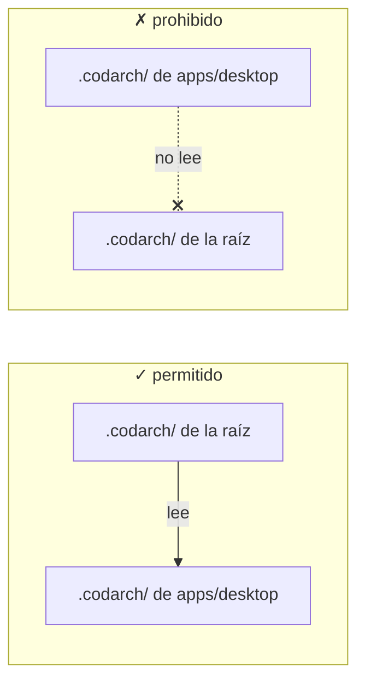

**Estado:** aceptado · **Fecha:** 2026-10-27

## Contexto

Un repositorio puede tener varios alcances: se analiza la raíz y, más tarde, `apps/desktop`, y cada
uno deja su `.codarch/` donde se invocó ([ADR 0050](../0041-0050/0050-el-repositorio-guarda-su-estado.md)).
El recorrido ignora `.codarch/` a cualquier profundidad, así que analizar la raíz **reparsea** todos
los ficheros que ya había parseado el hijo. En este repo, leer y parsear se lleva **2 194 ms de
2 819** ([ADR 0056](../0051-0060/0056-el-live-no-repite-el-analisis.md)); en un monorepo auditado por
paquetes, esa parte se paga otra vez en cada nivel.

La dirección importa y es una sola:

Hacia abajo se puede: el padre ve el trabajo de sus hijos. Hacia arriba no: un alcance parcial no
hereda el estado de un alcance mayor que no controla, y sigue en pie la regla de que el estado se
ancla donde se analiza. Lo prohibido es **leer**, no escribir: el padre tampoco escribe en el
`.codarch/` del hijo.

## Decisión

### 1. Se lee hacia abajo, nunca hacia arriba

Un análisis puede descubrir los `.codarch/` que viven **dentro de su raíz** y aprovechar lo que
contienen. Nunca mira los de un directorio superior. La dirección de la información va de fuera
adentro, y el alcance pequeño sigue siendo la autoridad de su carpeta.

### 2. Se reutiliza el parseo, no el snapshot

El snapshot no se fusiona ni se referencia. Un `cc.json` es autocontenido para ser interoperable, y
la resolución de imports, los ciclos, el fan-in y la migración dependen del conjunto: pegar dos
snapshots no da el mismo documento ni el mismo checksum.

Lo que sí se puede reutilizar es lo que no depende del alcance: **el parseo por fichero** que ya
guarda la caché del [ADR 0056](../0051-0060/0056-el-live-no-repite-el-analisis.md) —métricas,
importaciones, símbolos, exports y members—. El padre lo reindexa con su prefijo (`apps/desktop/`),
reutiliza las entradas cuya versión coincide y **rehace siempre** resolución, grafo, migración,
churn y snapshot. El resultado es indistinguible de un análisis desde cero.

### 3. La caché se persiste por alcance, y se lee con prueba

Cada `.codarch/` guarda su caché de parseo en un fichero derivado, ignorado por git como el resto
del estado. Una entrada solo se acepta si coinciden:

- la **versión** del fichero (`tamaño:mtime`, la misma del ADR 0056);
- el **formato** de la caché y la **identidad del parser** que la escribió;
- la **raíz** del alcance, para que una caché copiada a otra carpeta no se atribuya a rutas ajenas.

Si algo no cuadra, se ignora la entrada —o la caché entera— y se parsea. Una caché ilegible o de otra
versión nunca hace fallar el análisis.

### 4. El padre absorbe, no escribe hacia abajo

Al terminar, el padre persiste **su** caché, con las entradas reutilizadas de los hijos y las que
parseó él. Así el siguiente análisis por encima reutiliza el árbol completo desde un solo fichero.
No escribe en el `.codarch/` del hijo, no regenera su snapshot y no toca su historial: la autoridad
sobre un alcance es de quien analiza ese alcance. «Sincronizar» significa aquí que las entradas
suben, no que el estado baje.

### 5. Cada alcance lleva el registro de los que tiene debajo

Al analizar, el alcance apunta en **su propio** estado qué `.codarch/` ha visto por debajo, con su
checksum, su commit y su fecha. Es un registro de solo lectura sobre los hijos: sirve para ver la
deriva y saber qué alcance está al día sin abrir snapshots ajenos, y para que un análisis avise
«2 alcances anidados; 1 desactualizado» en lugar de callarse.

Lo escribe quien analiza ese alcance, y solo ese. Abrir la raíz o abrir `apps/desktop` no cambia el
dueño de ningún `.codarch/`: cada uno sigue teniendo un escritor. El registro es derivado y se puede
borrar; no es una prueba de nada, es un índice.

### 6. El invariante no cambia

**El checksum depende del código.** Un análisis con cachés de hijos y uno sin ellas tienen que
producir el mismo `cc.json`, byte a byte. La caché es una optimización de tiempo, no una fuente de
verdad.

## Consecuencias

- Analizar la raíz de un monorepo ya auditado por partes deja de repetir el parseo de esos paquetes.
  También acelera un `analyze` en frío: hoy la caché muere con el proceso.
- El snapshot del padre **no adelgaza**. Sigue conteniendo los ficheros del hijo, porque tiene que
  poder viajar solo. La duplicación de tamaño es el precio de `cc.json`, no un defecto de esta
  decisión.
- El `.codarch/` gana un fichero derivado más. Se puede borrar; solo cuesta tiempo volver a parsear.
- Un hijo con el snapshot viejo no contamina al padre: se reutiliza su parseo por versión, no sus
  conclusiones. La deriva entre alcances no es un problema de corrección, y el registro la enseña en
  una línea: checksum, commit y fecha de cada alcance.
- Analizar un hijo no gana nada de un padre, y sigue sin poder leerlo. La guarda de solo hacia abajo
  se mantiene intacta.

## Alternativas descartadas

- **Que el hijo lea al padre:** es la dirección roja. Un análisis parcial heredaría un estado que no
  ha producido y podría escribir sobre él; ya estaba descartado en el ADR 0050.
- **Fusionar o enlazar snapshots:** rompe la autocontención de `cc.json`, su checksum y los agregados
  que no se pueden concatenar. El mapa dejaría de ser un documento y pasaría a ser un grafo de
  ficheros que hay que resolver antes de leerlo.
- **Confiar en el snapshot del hijo mirando su `contentHash`:** obliga a rehacer igualmente la
  resolución y los agregados, ata el padre al formato interno de la lente y no ahorra la lectura.
- **Que el padre escriba hacia abajo, aunque sea solo lo que le falta al hijo:** invierte la
  autoridad, añade trabajo —hay que rehacer la agregación de cada alcance, que no se copia del
  padre— y aplica en silencio la política del padre a un hijo que puede tener su propio
  `.codarch.yml` ([ADR 0053](../0051-0060/0053-la-configuracion-no-se-mezcla.md)). Si algún día hace
  falta, será una acción explícita que analice el hijo **como su propio alcance**, nunca un efecto del
  análisis de la raíz.
- **Un libro de eventos encadenado por hashes, tipo Verifactu o cripto:** el estado es local, está
  ignorado y se puede borrar y regenerar, así que una cadena rota al limpiar una caché no prueba
  nada: es un falso positivo. El registro compartido e inmutable ya existe y es **git**, con
  `.codarch-history/` y `chains.json` encima y `codarch verify` para comprobarlo; una segunda cadena
  sobre un directorio regenerable es ceremonia, y un log compartido crecería y chocaría en cada
  análisis.
- **Una caché global de la máquina:** el estado de un proyecto vive en el proyecto (ADR 0050), y una
  caché compartida entre repos atribuiría parseos de un árbol a otro.

## Hoja de ruta

### M34 — El estado vive en el repositorio

- [ ] Descubrir los `.codarch/` descendientes y decir cuántos hay y qué ficheros cubren, sin
      reutilizar nada todavía.
- [ ] Persistir la caché de parseo por alcance con formato, parser y raíz; descartarla entera si no
      cuadra.
- [ ] Importar las entradas de los hijos a la caché del padre, reindexadas, y medir el ahorro en un
      monorepo con paquetes auditados. Si no llega a **un cuarto** del tiempo de parseo, no se envía.
- [ ] Test diferencial: el padre da el mismo checksum con y sin cachés de hijos, y editar un fichero
      del hijo invalida solo su entrada.
- [ ] Registrar en el estado del padre los `.codarch/` que tiene debajo, con su checksum, su commit
      y su fecha, y enseñarlos con `codarch scopes` para ver la deriva sin abrir el snapshot entero.

El registro de lo hecho vive en el [feed de la guía](/desarrollo/guia/).
