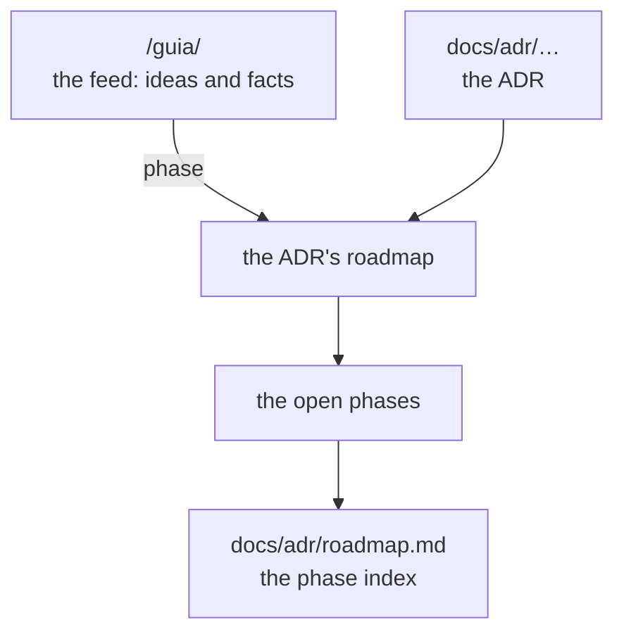

Every decision has its **roadmap** inside (`## Roadmap`). The **record** of what is done and what
is coming lives in the [guide feed](/guia/). This is the index: number, title, date, status and
phases.

| ADR | Decision | Date | Status | Phases |
|---|---|---|---|---|
| [0001](0001-0010/0001-clean-room-con-ccjson.md) | Clean-room, with `cc.json` as the boundary | 2026-10-20 | accepted | applies to M0 |
| [0002](0001-0010/0002-monorepo-core-first.md) | Core-first monorepo | 2026-10-20 | accepted | applies to M0, M1 |
| [0003](0001-0010/0003-typescript-first.md) | TypeScript first, Rust when a benchmark demands it | 2026-10-20 | accepted | M1 |
| [0004](0001-0010/0004-cuna-pr-ci-mcp.md) | The wedge: PR/CI + MCP | 2026-10-20 | accepted | applies to M2, M3 |
| [0005](0001-0010/0005-2d-first.md) | 2D first, 3D as a lens | 2026-10-20 | accepted | M0 |
| [0006](0001-0010/0006-nodos-fichero.md) | Nodes are files, ready for symbols | 2026-10-20 | accepted | applies to M0 |
| [0007](0001-0010/0007-nombre-codarch.md) | The name: CodArch | 2026-10-20 | accepted | applies to M0 |
| [0008](0001-0010/0008-diseno-mapa-2d.md) | 2D map design | 2026-10-20 | accepted | M5, M5.1 |
| [0009](0001-0010/0009-churn-desde-git.md) | Churn from git, without breaking determinism | 2026-10-20 | accepted | applies to M2 |
| [0010](0001-0010/0010-diff-entre-snapshots.md) | Diff between snapshots and a stable report | 2026-10-20 | accepted | M2 |
| [0011](0011-0020/0011-reglas-de-arquitectura.md) | Architecture rules in `.codarch.yml` | 2026-10-20 | accepted | applies to M2, M9 |
| [0012](0011-0020/0012-github-action.md) | GitHub Action for PRs | 2026-10-20 | accepted | applies to M2 |
| [0013](0011-0020/0013-mcp-readonly.md) | Read-only MCP server | 2026-10-20 | accepted | applies to M3 |
| [0014](0011-0020/0014-distribucion-cli-npm.md) | CLI distribution as a single npm package | 2026-10-20 | accepted | M3 |
| [0015](0011-0020/0015-accion-publica-separada.md) | Separate public action | 2026-10-20 | accepted | applies to M3 |
| [0016](0011-0020/0016-lente-migracion.md) | Migration lens v1 | 2026-10-20 | accepted | M4 |
| [0017](0011-0020/0017-servidor-local.md) | Local server `codarch serve` | 2026-10-20 | accepted | applies to M5, M5.1 |
| [0018](0011-0020/0018-estado-vista-en-la-url.md) | View state in the URL and loading by URL | 2026-10-21 | accepted | applies to M5, M5.1 |
| [0019](0011-0020/0019-nivel-de-detalle-del-mapa.md) | Map level of detail | 2026-10-21 | accepted | applies to M5, M5.1 |
| [0020](0011-0020/0020-analisis-en-el-navegador.md) | Analysis in the browser with the same grammar as the CLI | 2026-10-21 | accepted | M6 |
| [0021](0021-0030/0021-app-de-escritorio.md) | Desktop app (Electron) with its own interface | 2026-10-21 | accepted | M7 · shared UI in 0043 |
| [0022](0021-0030/0022-la-migracion-donde-faltaba.md) | Migration, where it was still missing | 2026-10-21 | accepted | M8 |
| [0023](0021-0030/0023-lente-de-dominio-por-pasos.md) | Domain lens, step by step | 2026-10-21 | accepted | M9 |
| [0024](0021-0030/0024-evolucion-temporal.md) | Time evolution: heat and history | 2026-10-21 | accepted | M10 |
| [0025](0021-0030/0025-lente-de-simbolos.md) | The symbols lens: looking inside the file | 2026-10-21 | accepted | M11 |
| [0026](0021-0030/0026-la-vida-de-un-simbolo.md) | The life of a symbol: the chain that survives renaming | 2026-10-21 | accepted | M12 |
| [0027](0021-0030/0027-los-ajustes.md) | Settings: one place to configure everything | 2026-10-21 | accepted | M13 |
| [0028](0021-0030/0028-los-plugins.md) | Plugins: pieces of the repo that are switched on | 2026-10-21 | accepted | M14, M15 |
| [0029](0021-0030/0029-los-addons.md) | Addons: declarative knowledge | 2026-10-22 | accepted | M16 |
| [0030](0021-0030/0030-instalar-y-quitar.md) | Installing and removing: plugins and addons | 2026-10-22 | accepted | M17 |
| [0031](0031-0040/0031-los-documentos.md) | Documents: every decision with its roadmap | 2026-10-22 | accepted | M18, M19, M20 |
| [0032](0031-0040/0032-las-versiones-y-las-actualizaciones.md) | Versions and updates | 2026-10-22 | accepted | M21 |
| [0033](0031-0040/0033-abrir-el-repo.md) | Opening the repo: what must be in place first | 2026-10-22 | accepted | M22 |
| [0034](0031-0040/0034-la-web-del-proyecto.md) | The project website | 2026-10-22 | accepted | M23 |
| [0035](0031-0040/0035-la-guia-como-changelog.md) | The guide reads like a changelog | 2026-10-22 | accepted | M23.6–M23.9 |
| [0036](0031-0040/0036-el-roadmap-en-el-adr-y-el-changelog.md) | The roadmap lives in the ADR, the changelog next to it | 2026-10-22 | accepted · 0047 | M23, M24 |
| [0037](0031-0040/0037-los-ciclos-de-ejecucion.md) | Cycles: runtime, not type | 2026-10-23 | accepted | applies to M2, M9 |
| [0038](0031-0040/0038-el-alcance-del-analisis.md) | The analysis scope is declared in `.codarch.yml` | 2026-10-23 | accepted | applies to M2, M5 |
| [0039](0031-0040/0039-la-busqueda-de-una-cadena.md) | Searching for a chain: symbols, not nodes | 2026-10-23 | accepted | applies to M12 |
| [0040](0031-0040/0040-la-complejidad-del-cuerpo-entero.md) | Complexity counts the whole body | 2026-10-23 | accepted | applies to M0, M11 |
| [0041](0041-0050/0041-cada-version-una-vez.md) | Every version is declared once | 2026-10-23 | accepted | applies to the whole repo |
| [0042](0041-0050/0042-la-entrega-se-automatiza.md) | Delivery is automated | 2026-10-23 | accepted | M25 |
| [0043](0041-0050/0043-la-ui-compartida.md) | The UI is shared as a package | 2026-10-23 | accepted | M26 |
| [0044](0041-0050/0044-la-web-en-docker.md) | The web app in a local container | 2026-10-23 | accepted | M27 |
| [0045](0041-0050/0045-el-escritorio-se-instala-y-se-actualiza.md) | The desktop installs and updates better | 2026-10-23 | accepted | M28 |
| [0046](0041-0050/0046-los-documentos-con-starlight.md) | Documents are published with Starlight | 2026-10-23 | accepted | M29 |
| [0047](0041-0050/0047-el-changelog-es-la-guia.md) | The changelog is the guide | 2026-10-23 | accepted | M30 |
| [0048](0041-0050/0048-el-escritorio-persiste-en-codarch.md) | The desktop persists in the repo's `.codarch/` | 2026-10-24 | accepted | M32 |
| [0049](0041-0050/0049-la-orquestacion-se-comparte.md) | The orchestration is shared, the platform adapts | 2026-10-24 | accepted | M33 |

## The folders

They go in blocks of ten: the number says when it was decided and the title says the topic.

- **0001-0010**: 0001, 0002, 0003, 0004, 0005, 0006, 0007, 0008, 0009, 0010
- **0011-0020**: 0011, 0012, 0013, 0014, 0015, 0016, 0017, 0018, 0019, 0020
- **0021-0030**: 0021, 0022, 0023, 0024, 0025, 0026, 0027, 0028, 0029, 0030
- **0031-0040**: 0031, 0032, 0033, 0034, 0035, 0036, 0037, 0038, 0039, 0040
- **0041-0050**: 0041, 0042, 0043, 0044, 0045, 0046, 0047, 0048, 0049

The full **roadmap**, with one line per phase, is in [`roadmap.md`](roadmap.md).
