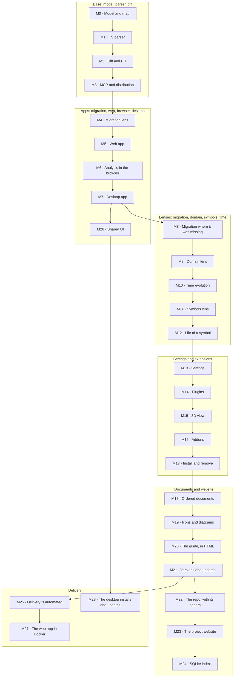

Every milestone leaves the product working and verifiable. No big bang.

## Status

Today CodArch has:

- **CLI** (`codarch`): `analyze`, `diff`, `render`, `inspect` and `serve`. Published on npm.
- **Model** `cc.json` 2.x: file tree, metrics, dependency graph, cycles, migration lens and a
  deterministic checksum. It is the truth of the product and all apps share it.
- **Rules** of architecture in `.codarch.yml`: layers, forbidden dependencies, thresholds and
  cycles, with severity and a blocking policy.
- **MCP** read-only: nine queries for agents.
- **GitHub Action**: analyses the PR's base and head, comments the result and blocks if the policy
  fails.
- **Web app**: map, inspector, PR view, level of detail for large repos and analysis of a folder in
  the browser with the same checksum as the CLI.
- **Desktop app**: Electron with its own interface, native analysis with git, system menu and
  unsigned installers.

Phases M0-M22 are closed. M23 is in progress, M24 not started, M25 closed, M26 closed, M27 closed,
M28 closed, M29 closed, M30 closed, M31 in progress, M32 closed and M33 closed.

## The phases

Each phase lives in the **roadmap of the decision that brings it**: the ADR has a `## Roadmap`
section with what is open and what is in progress. Here is only the **index**; the record of what
is done lives in the **guide feed** ([`/guia/`](/guia/)). If a phase grows, it grows in its ADR, not
here.

| Phase | What | Status | Decision |
|---|---|---|---|
| M0 | Model and map, without parsers | closed | [ADR 0005](0001-0010/0005-2d-first.md) |
| M1 | Our own TypeScript parser | closed | [ADR 0003](0001-0010/0003-typescript-first.md) |
| M2 | Diff and PR | closed | [ADR 0010](0001-0010/0010-diff-entre-snapshots.md) |
| M3 | MCP and distribution | closed | [ADR 0014](0011-0020/0014-distribucion-cli-npm.md) |
| M4 | Migration lens | closed | [ADR 0016](0011-0020/0016-lente-migracion.md) |
| M5 | Web app | closed | [ADR 0008](0001-0010/0008-diseno-mapa-2d.md) |
| M5.1 | Usage basics | closed | [ADR 0008](0001-0010/0008-diseno-mapa-2d.md) |
| M6 | Analysis in the browser | closed | [ADR 0020](0011-0020/0020-analisis-en-el-navegador.md) |
| M7 | Desktop app | closed | [ADR 0021](0021-0030/0021-app-de-escritorio.md) |
| M8 | Migration, where it was still missing | closed | [ADR 0022](0021-0030/0022-la-migracion-donde-faltaba.md) |
| M9 | Domain lens, step by step | closed | [ADR 0023](0021-0030/0023-lente-de-dominio-por-pasos.md) |
| M10 | Time evolution | closed | [ADR 0024](0021-0030/0024-evolucion-temporal.md) |
| M11 | The symbols lens | closed | [ADR 0025](0021-0030/0025-lente-de-simbolos.md) |
| M12 | The life of a symbol | closed | [ADR 0026](0021-0030/0026-la-vida-de-un-simbolo.md) |
| M13 | Settings | closed | [ADR 0027](0021-0030/0027-los-ajustes.md) |
| M14 | Plugins | closed | [ADR 0028](0021-0030/0028-los-plugins.md) |
| M15 | The 3D view | closed | [ADR 0028](0021-0030/0028-los-plugins.md) |
| M16 | Addons | closed | [ADR 0029](0021-0030/0029-los-addons.md) |
| M17 | Installing and removing plugins and addons | closed | [ADR 0030](0021-0030/0030-instalar-y-quitar.md) |
| M18 | Ordered documents | closed | [ADR 0031](0031-0040/0031-los-documentos.md) |
| M19 | Documents, with icons and diagrams | closed | [ADR 0031](0031-0040/0031-los-documentos.md) |
| M20 | The guide, in HTML | closed | [ADR 0031](0031-0040/0031-los-documentos.md) |
| M21 | Versions and updates | closed | [ADR 0032](0031-0040/0032-las-versiones-y-las-actualizaciones.md) |
| M22 | The repo, with its papers | closed | [ADR 0033](0031-0040/0033-abrir-el-repo.md) |
| M23 | The project website | in progress | [ADR 0034](0031-0040/0034-la-web-del-proyecto.md#hoja-de-ruta) |
| M24 | The SQLite index of the documents | not started | [ADR 0036](0031-0040/0036-el-roadmap-en-el-adr-y-el-changelog.md#hoja-de-ruta) |
| M25 | Delivery is automated | closed | [ADR 0042](0041-0050/0042-la-entrega-se-automatiza.md#hoja-de-ruta) |
| M26 | Shared UI | closed | [ADR 0043](0041-0050/0043-la-ui-compartida.md#hoja-de-ruta) |
| M27 | The web app in Docker | closed | [ADR 0044](0041-0050/0044-la-web-en-docker.md#hoja-de-ruta) |
| M28 | The desktop installs and updates | closed | [ADR 0045](0041-0050/0045-el-escritorio-se-instala-y-se-actualiza.md#hoja-de-ruta) |
| M29 | Documents with Starlight | closed | [ADR 0046](0041-0050/0046-los-documentos-con-starlight.md#hoja-de-ruta) |
| M30 | The changelog is the guide | closed | [ADR 0047](0041-0050/0047-el-changelog-es-la-guia.md#hoja-de-ruta) |
| M31 | The site in two languages | in progress | [ADR 0046](0041-0050/0046-los-documentos-con-starlight.md#hoja-de-ruta) |
| M32 | The desktop persists in `.codarch/` | closed | [ADR 0048](0041-0050/0048-el-escritorio-persiste-en-codarch.md#hoja-de-ruta) |
| M33 | Shared orchestration | closed | [ADR 0049](0041-0050/0049-la-orquestacion-se-comparte.md#hoja-de-ruta) |

## How to read this

- A phase **is born in the roadmap of its decision** (`## Roadmap` in the ADR); here only its line is
  added.
- A decision that grows **grows its roadmap** and leaves what is done in the **guide**, not in this
  file.
- Ideas that are **not a phase yet** live in the [guide](/guia/), in chronological order.
- The index of **decisions** —with their date and status— is in [`docs/adr/index.md`](index.md).
