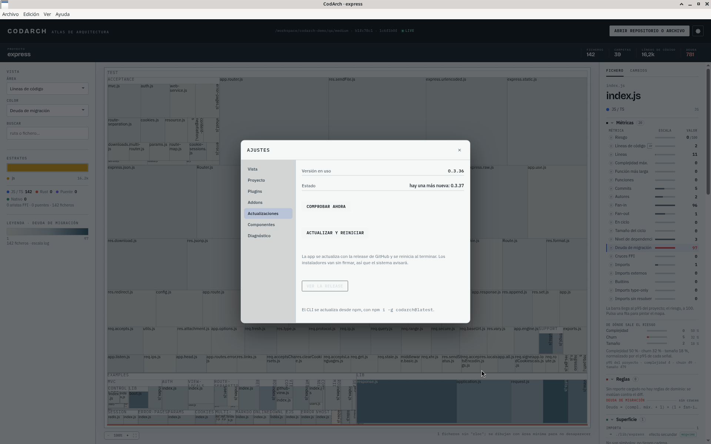

## CLI (npm)

```sh
codarch version --check   # asks npm whether a newer version exists
npm i -g codarch@latest   # installs the latest one
```

`codarch version --check` queries the npm registry and tells you whether a newer version exists; it exits 1 only if the check failed.

## Docker

The `latest` tag moves with every release; an exact version (`0.3.36`, …) never changes.

```sh
docker pull ghcr.io/jaminsmoke/codarch-web:latest
```

Then start the container again. For reproducible setups, pin an exact version and bump it by hand.
With Compose from a clone: `git pull` and `docker compose up --build`.

## Desktop app

The app updates itself on Windows and Linux. On start it checks the GitHub releases, picks the
highest version (prereleases included) and downloads the installer in the background. The main
window shows no notice: the status lives in **Settings › Updates** (Ajustes › Actualizaciones),
with "Check now" and the **«Actualizar y reiniciar»** (Update and restart) button.



Since 0.3.37, pressing «Actualizar y reiniciar» installs the new version and reopens the app by
itself. If you do not press it, the update is applied when you quit the app.

| Install | How it is applied |
| --- | --- |
| Windows (`.exe`) | NSIS installer with differential download. |
| Linux AppImage | Replaces the AppImage in your user folder, no permissions needed. |
| Linux `.deb` | Installed with `dpkg`: **the system asks for your admin password**. |

macOS has no auto-update: there is no signed installer yet.
