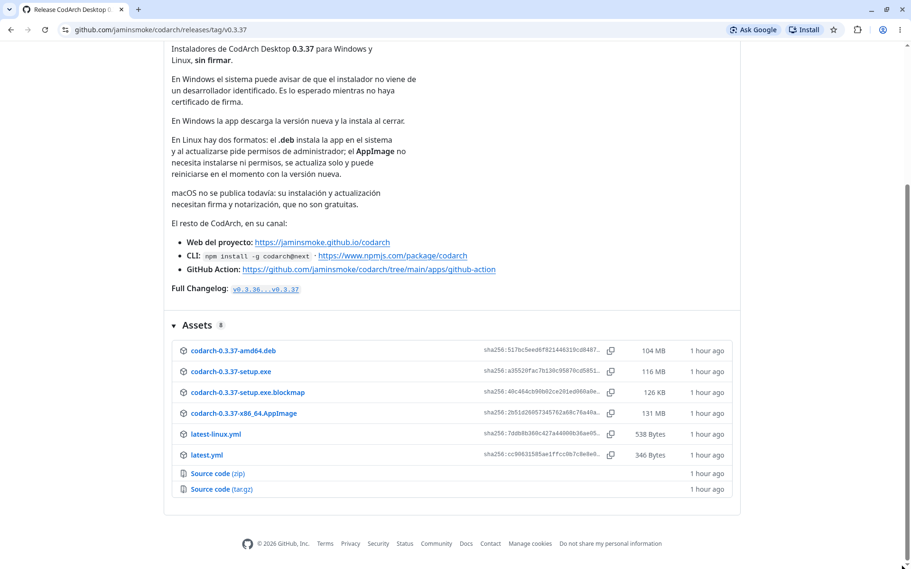
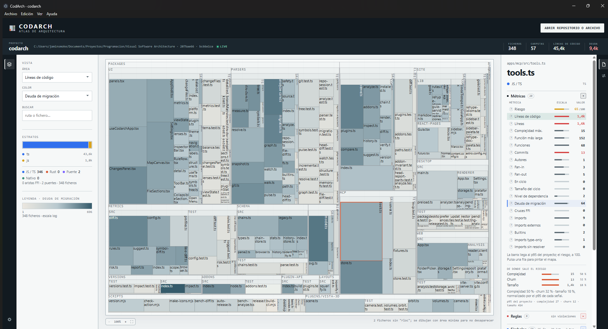
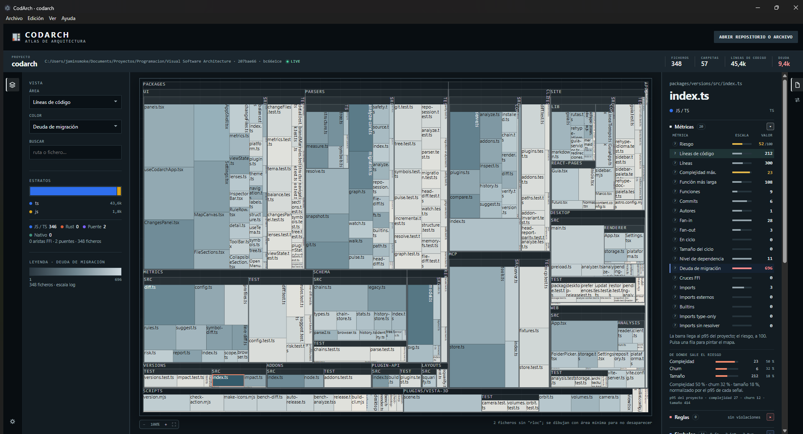
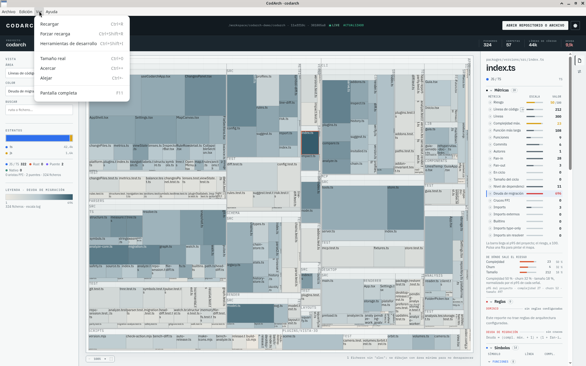
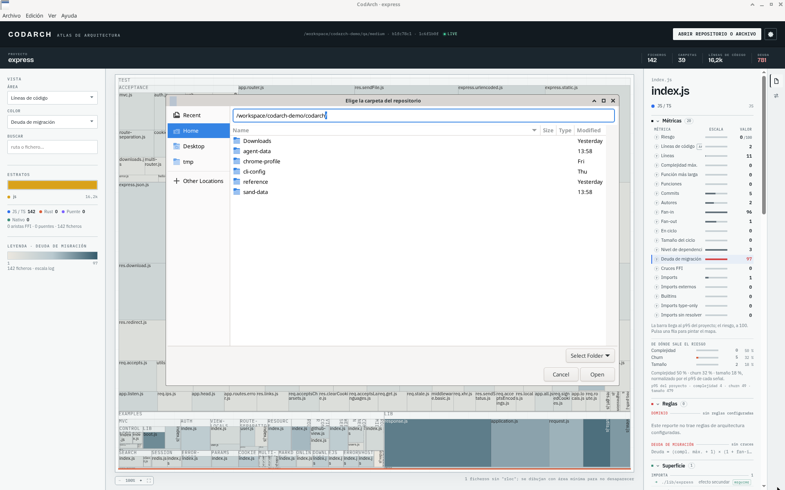
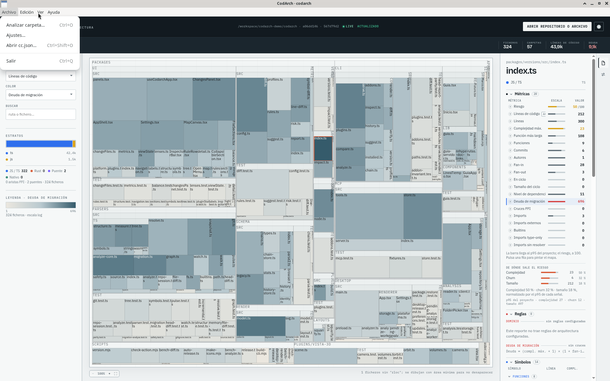
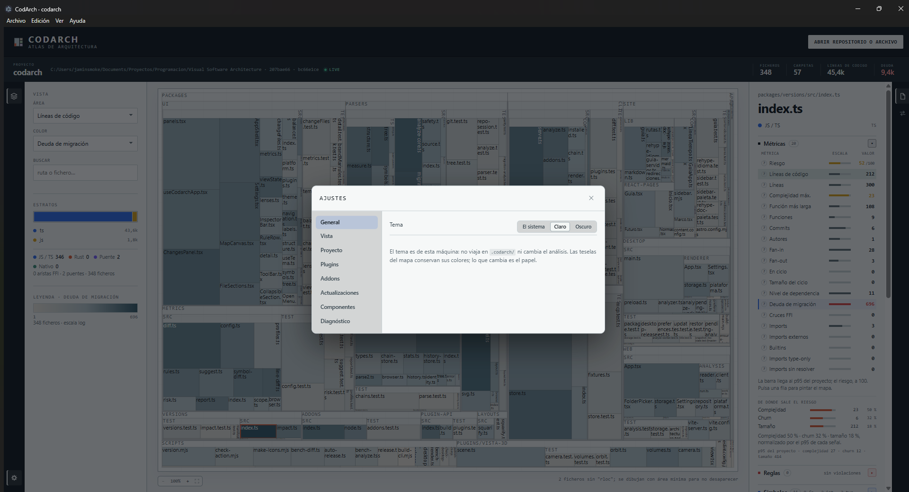
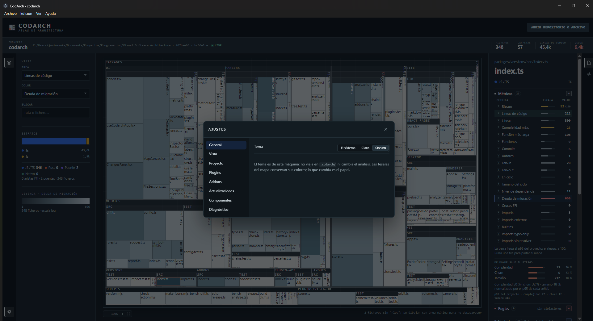
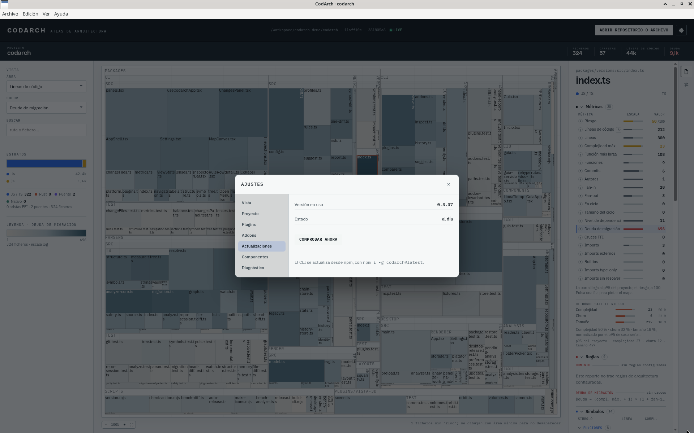

The desktop app is CodArch in a native window (Electron). It analyses with the same engine as the
CLI, so the snapshot has the same checksum, but it does so against the real disk and with git: the
snapshot carries churn and there are no browser limits.

## Install

Download your system's installer from the
[repository Releases](https://github.com/jaminsmoke/codarch/releases):

| System | File | What it does |
|---|---|---|
| Windows | `codarch-<version>-setup.exe` (NSIS) | per-user install in `%LOCALAPPDATA%\Programs\CodArch`, no administrator needed |
| Linux | `codarch-<version>-amd64.deb` | installs the app system-wide, with its menu entry |
| Linux | `codarch-<version>-x86_64.AppImage` | runs without installing anything (`chmod +x` and open) |

macOS is not published: without signing or notarisation, Gatekeeper blocks the app. The installers
are **unsigned**; see the [FAQ](preguntas-frecuentes.md#windows-or-linux-warn-that-the-installer-is-not-signed).

## The window

The window shows the same interface as the [web app](webapp.md): the VISTA panel, the map and the
inspector. The interface is in Spanish; this page uses the names as they appear on screen.

The theme is picked in **Ajustes › General**, the same as in the web app: light or dark paper belongs
to the machine and the map's tiles keep their colour.

## Archivo, Edición, Ver and Ayuda menus

On top of the interface, the app has native menus: **Archivo** (file), **Edición** (edit), **Ver**
(view) and **Ayuda** (help).

## Elige la carpeta del repositorio

There are three ways to open a repo, from most to least common:

- **ABRIR REPOSITORIO O ARCHIVO**: the header button opens a drop-down with **Analizar carpeta…**
  (analyse folder), **Archivo cc.json…** (cc.json file) and **Reporte JSON…** (JSON report). It is the
  main way and works the same as in the [web app](webapp.md#abrir-repositorio-o-archivo).
  **Analizar carpeta…** opens the native **Elige la carpeta del repositorio** (choose the repository
  folder) dialog. The Archivo menu has the same actions.
- **Shortcuts**: `Ctrl+O` analyses a folder, `Ctrl+Shift+O` opens a JSON.
- **A path on start**: the app accepts a folder, a `cc.json` or a `report.json` as an argument and
  opens it right after starting. The installers do not register file associations, so the app does
  not show up in «Open with» on its own: pick it by hand in that file-explorer menu or pass it the
  path from a terminal (`/opt/CodArch/codarch /path/to/repo` with the `.deb`,
  `./codarch-<version>-x86_64.AppImage /path/to/repo` with the AppImage).

## The .codarch/ folder

The repo state is saved in its `.codarch/` folder, not in the app. What CodArch writes there:

| File | What it is |
|---|---|
| `snapshot.cc.json` | the latest snapshot |
| `rest.cc.json` | the map of what is not code (documents, configuration and assets) |
| `head-report.json` | what was touched since the last commit |
| `report.json` | a diff report, only if one was loaded |
| `chains.json` | the symbol chain ledger |
| `preferences.json` | the view preferences |

History snapshots do not go here but in `.codarch-history/`, at the repo root. Neither does a static
map: [`codarch render`](cli/render.md) copies the whole web app to the folder you give it, with the
snapshot in `data/snapshot.cc.json`.

## Ajustes › General

The first section of Ajustes picks the theme: **Claro**, **Oscuro** or **El sistema** (see
[Ajustes › General](webapp.md#ajustes--general) in the web app). In the desktop app the preference
lives in the app, not in the repository.

## Ajustes › Actualizaciones

Updates only show up in **Ajustes › Actualizaciones** (settings › updates): it shows the installed
version and whether it is up to date. There is no banner; when a new version exists, the notice
appears in that section. The AppImage updates without permissions; the `.deb` asks for the
administrator password, like any package. See [Updates](actualizaciones.md).

