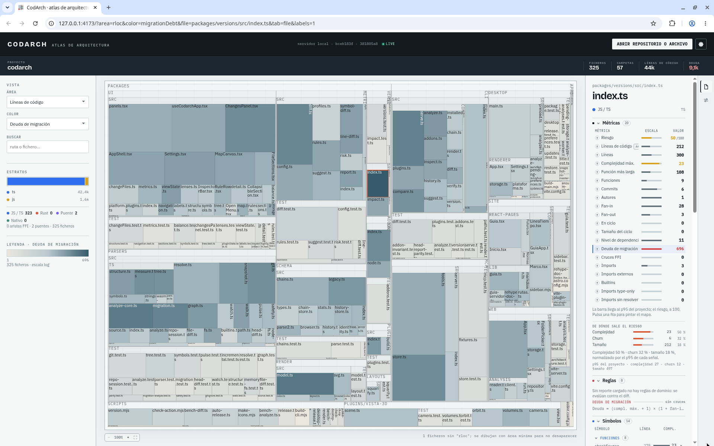
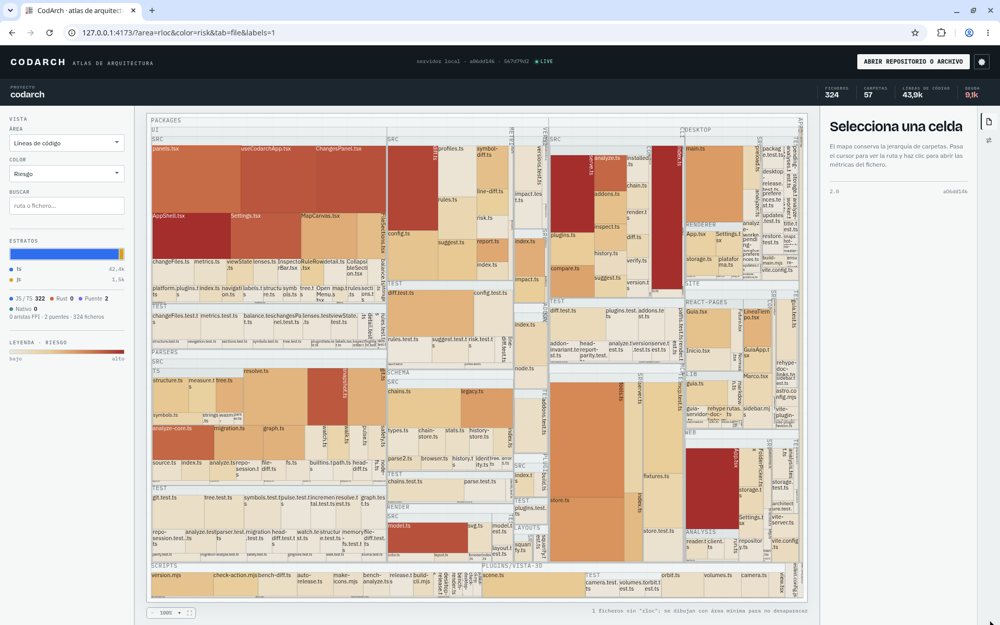
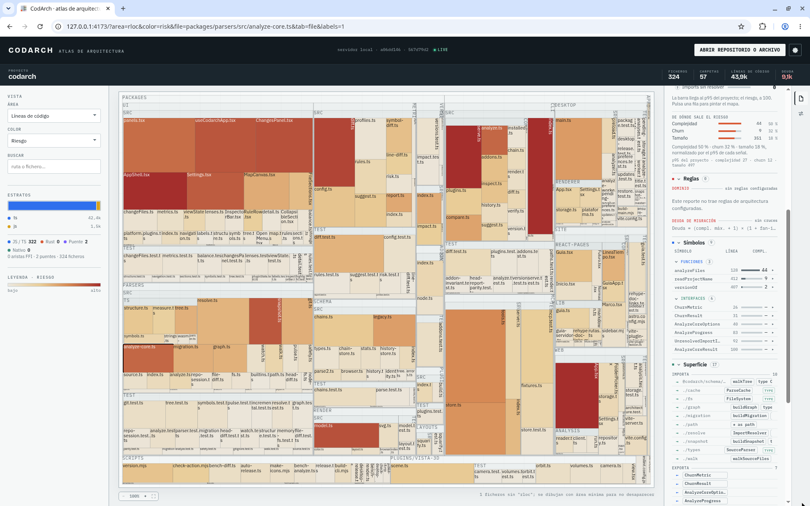

Esta página da por hecho que ya tienes CodArch instalado por una de sus tres vías (ver
[Instalación](instalacion.md)). Los ejemplos usan el CLI; con Docker o el escritorio el resultado es el
mismo `cc.json`, con el mismo checksum.

## 1. Analiza tu repositorio

Desde la raíz del proyecto:

```bash
codarch analyze .
```

Deja el snapshot en `.codarch/snapshot.cc.json`: el árbol de ficheros y carpetas, las métricas, el
grafo de dependencias y, si hay git, el historial. Ver [`codarch analyze`](cli/analyze.md).

## 2. Abre la webapp

```bash
codarch serve .
```

La webapp viaja dentro del CLI: `serve` no instala nada, la sirve en local, analiza el repo y vuelve a
analizar al guardar. Ver [Webapp](webapp.md) y [`codarch serve`](cli/serve.md).

Para abrir otro repositorio, en la webapp o en el escritorio:

1. **ABRIR REPOSITORIO O ARCHIVO**, en la cabecera: abre un desplegable con **Analizar carpeta…**,
   **Archivo cc.json…** y **Reporte JSON…** (en la webapp, ver sus opciones en
   [Webapp](webapp.md#abrir-repositorio-o-archivo)).
2. Solo en el escritorio: `Ctrl+O` analiza una carpeta y `Ctrl+Shift+O` abre un JSON.
3. Solo en el escritorio: pasar la ruta como argumento al arrancar (ver
   [Escritorio](escritorio.md#elige-la-carpeta-del-repositorio)).



## 3. Lee el mapa

- Cada bloque es una carpeta o un fichero. El tamaño y el color se eligen con los selectores **ÁREA** y
  **COLOR** del panel **VISTA**; al abrir, el color es Deuda de migración.
- Al pulsar un fichero, el **inspector** de la derecha lo muestra en su pestaña **Fichero**: métricas,
  símbolos y dependencias entrantes y salientes.
- La búsqueda encuentra ficheros y símbolos por nombre.



## 4. Siguientes pasos

- Escribe una política en [`.codarch.yml`](reglas.md) y compárala con [`codarch diff`](cli/diff.md).
- Pon el mapa en cada pull request con la [GitHub Action](github-action.md).
- Deja que tu agente pregunte por la arquitectura con el [MCP](mcp.md).
