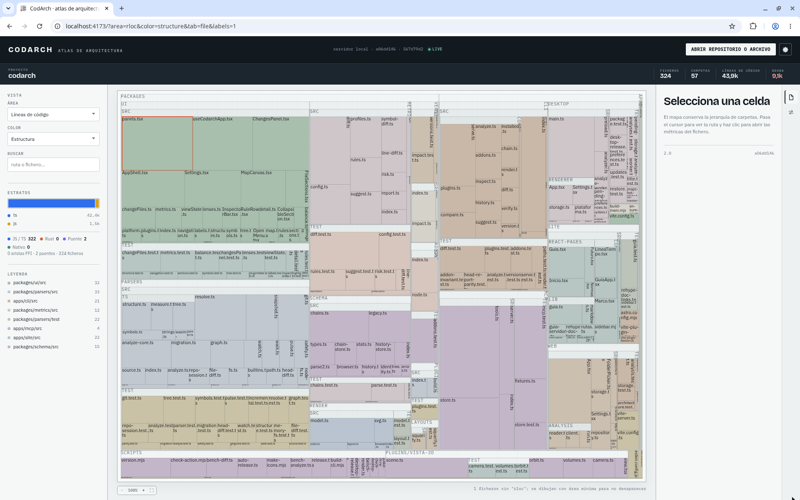
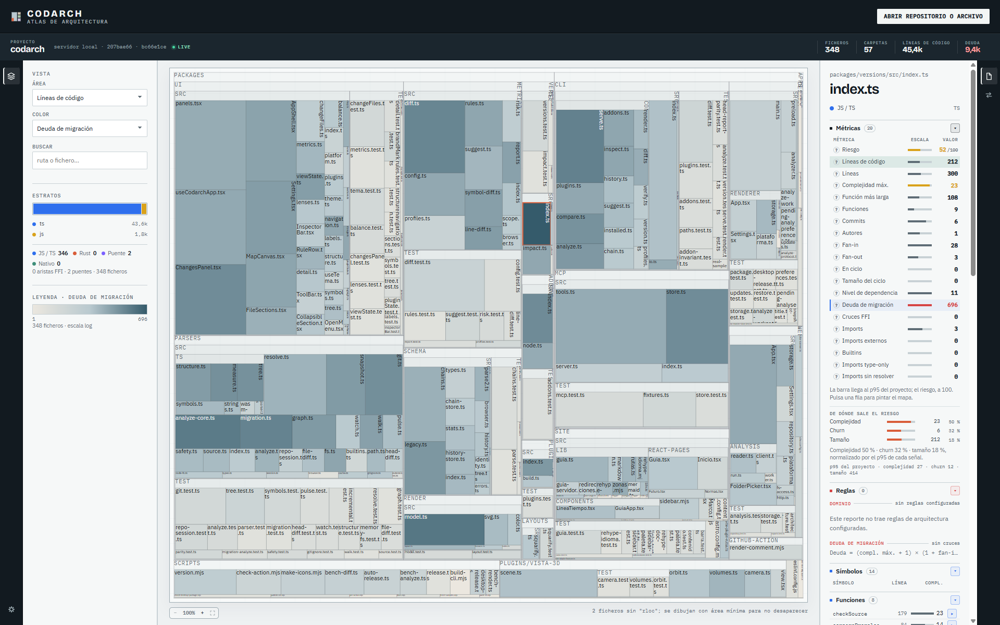
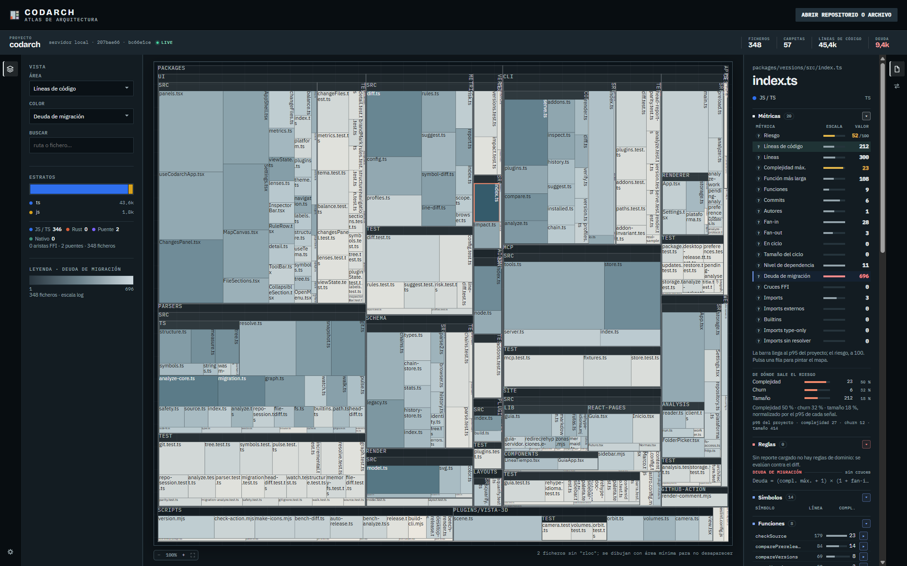
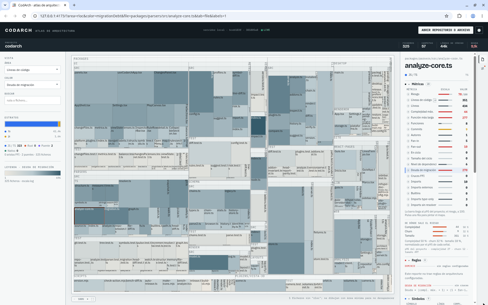
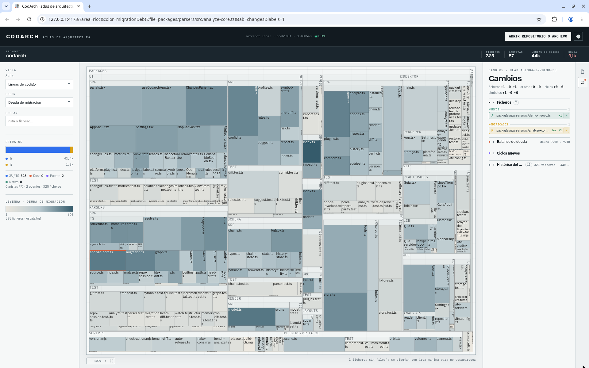
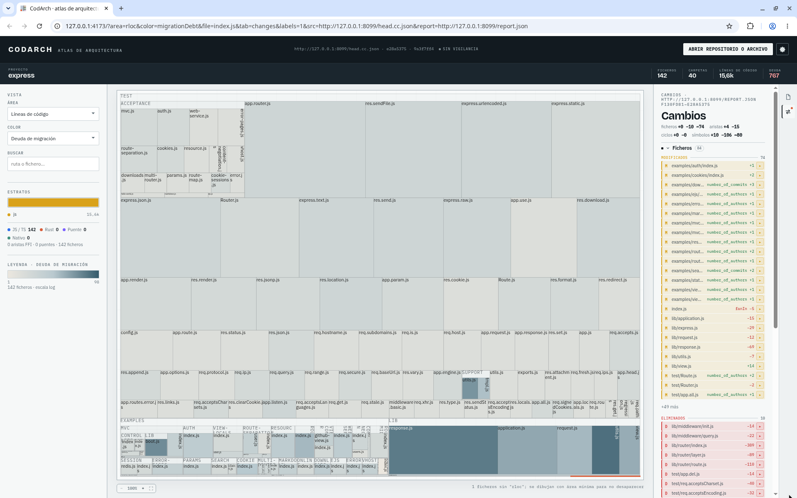
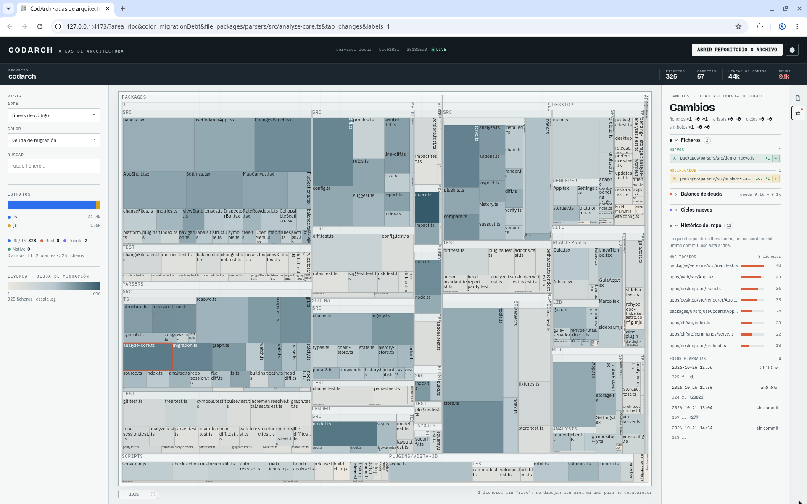
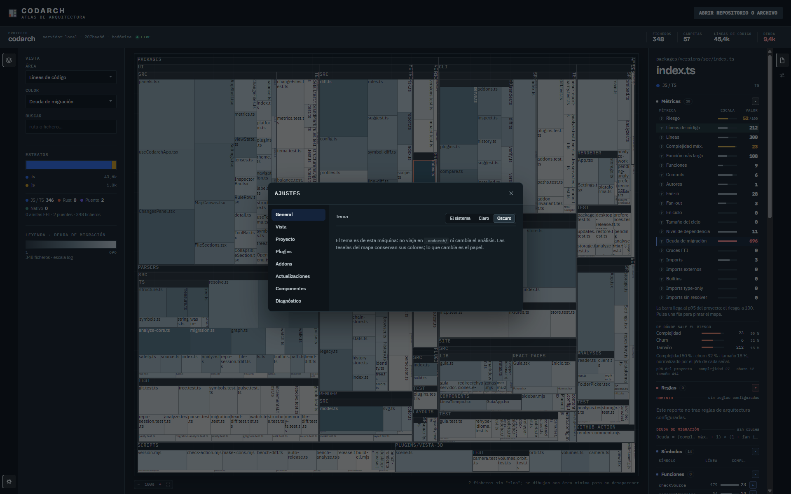
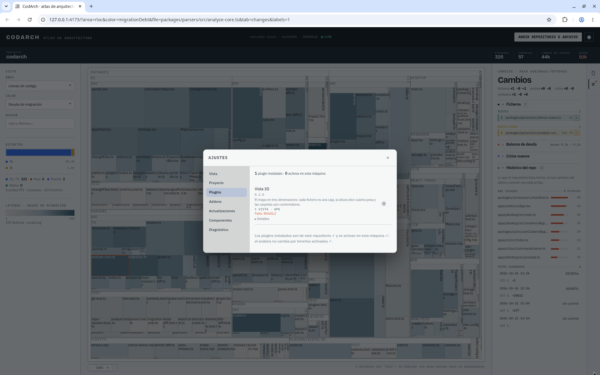

La webapp es el mapa en el navegador: el treemap, el panel VISTA con sus selectores ÁREA y COLOR, y
el inspector con sus pestañas Fichero y Cambios. **No analiza sola en el navegador**: analiza a
través de `codarch serve`, que lee el repositorio del disco y le pasa el snapshot.

## Dos formas de abrirla

### Con el CLI (la misma instalación)

`npm i -g codarch` ya trae la webapp. Se abre con:

```bash
codarch serve .
```

`serve` no es otra forma de instalar: sirve la webapp que viene con el CLI, en local, y reanaliza al
guardar. Su versión es la del CLI. Ver [`codarch serve`](cli/serve.md).

### Sola, con Docker

Sin instalar Node, con la imagen publicada y tu repo montado en solo lectura:

```bash
docker run --rm -p 127.0.0.1:4173:4173 \
  -v "$PWD":/workspace:ro \
  ghcr.io/jaminsmoke/codarch-web:latest
```

Abre `http://localhost:4173`. Dentro corre el mismo `codarch serve` sobre `/workspace`; el
contenedor escucha solo en loopback y no escribe en el repo.

Si has clonado el repositorio de CodArch, también puedes construirla y arrancarla desde él:

```bash
docker compose up --build
CODARCH_REPO=/ruta/al/repo docker compose up --build   # para mirar otro repo
```



## El mapa: ÁREA y COLOR

Cada bloque es una carpeta o un fichero. No hay un menú de «lentes»: son los dos selectores del panel
**VISTA**, a la izquierda.

- **ÁREA** decide el tamaño de cada bloque (la métrica).
- **COLOR** decide cómo se pinta: Riesgo, Estructura, Color (commits), Estado de migración, Deuda de
  migración, entre otros. Al abrir un repo, la lente por defecto es Deuda de migración.

El icono de capas, en la barra de herramientas de la izquierda, pliega ese panel y deja el mapa a
pantalla completa; la app recuerda si estaba plegado.



Con el tema oscuro, el papel baja y las teselas conservan su color: el mapa se sigue leyendo igual
(ver [Ajustes › General](#ajustes--general)).



## La ruta del mapa

Encima del mapa está siempre la ruta. Sin carpeta enfocada dice solo **Todo**, que es donde estás;
al entrar en una carpeta, cada tramo se vuelve un botón: `Todo / packages / ui`. Un clic en un tramo
**selecciona** esa carpeta —su ficha aparece en el panel derecho sin mover el zoom— y con **doble
clic** entras en ella; **Todo** selecciona el mapa entero. La flecha sube un nivel y `Esc` y el
retroceso limpian la vista. La ruta navega el mapa, no describe el proyecto, y por eso vive aquí y no
en la banda de arriba.

En el mapa, un clic **selecciona** lo que hay en la celda —un fichero o una carpeta— y un **doble
clic** entra: el fichero abre su código, la carpeta hace zoom. Con el teclado, `Enter` entra y
`Espacio` selecciona. La carpeta seleccionada va en la URL con la clave `sel`; el fichero, con
`file`.

Con **doble clic** en el bloque de un fichero, el mapa deja su sitio a su código completo, de solo
lectura: la ruta pasa a ser `Todo / packages / ui / useCodarchApp.tsx` y cualquier tramo —o `Esc`, o
el botón **← Mapa** de la cabecera— devuelve el mapa. No hay pestaña ni vista aparte, y el fichero
sigue seleccionado en la ficha. El fichero abierto va en la URL con la clave `code`, así que un
enlace compartido abre ese código directamente.

## ABRIR REPOSITORIO O ARCHIVO

Es la forma principal de abrir un repositorio, aquí y en el [escritorio](escritorio.md). El botón de
la cabecera **ABRIR REPOSITORIO O ARCHIVO** abre un desplegable con estas opciones:

- **Monitorizar carpeta (live)…**: analiza la carpeta y vuelve a analizar al guardar.
- **Carpeta con .codarch…**: abre lo que ya hay en la carpeta `.codarch/` de un repo.
- **Analizar carpeta aquí…**: analiza una carpeta una vez.
- **Archivo cc.json…**: abre un snapshot suelto.
- **Copiar enlace de la vista**: copia la URL con la vista actual.

Debajo están los campos **SNAPSHOT POR URL** y **REPORTE POR URL (OPCIONAL)**, con el botón
**CARGAR POR URL**.

En el escritorio el mismo botón ofrece **Analizar carpeta…**, **Archivo cc.json…** y **Reporte JSON…**.
Solo allí hay, además, atajos de teclado (`Ctrl+O`, `Ctrl+Shift+O`) y se puede pasar la ruta como
argumento al arrancar (ver [Escritorio](escritorio.md#elige-la-carpeta-del-repositorio)).

## Inspector › Fichero

El inspector es el panel de la derecha y tiene tres entradas en su barra de actividad: **Fichero**,
**Carpeta** y **Cambios**. Al pulsar un fichero, **Fichero** muestra sus métricas, sus símbolos y sus
dependencias entrantes y salientes. Al pulsar una carpeta, **Carpeta** muestra cuántos ficheros
tiene, en qué nivel está y qué parte de su área ocupa cada hijo, en el mismo orden que el mapa;
seleccionar un fichero vuelve a **Fichero**.



## Inspector › Carpeta

**Carpeta** es la hoja de la carpeta seleccionada: su ruta, sus ficheros, su nivel y su contenido,
con la parte del área que ocupa cada hijo y los ficheros que lleva dentro. Pulsar un hijo lo
selecciona —si es un fichero, pasa a **Fichero**—. Las métricas agregadas de la carpeta, su frontera
de dependencias y sus ciclos están en la hoja de ruta de esta fase.

## Inspector › Cambios

La pestaña **Cambios** muestra lo que ha cambiado: lo tocado desde el último commit y, si se ha
cargado un reporte, los ficheros modificados y eliminados con sus reglas.



## Comparar dos versiones: REPORTE POR URL

No hay una vista propia de PR ni de diff. Para comparar dos versiones:

1. Genera el reporte con el CLI:

   ```bash
   codarch diff base.cc.json head.cc.json -o reporte.json
   ```

2. Carga el snapshot de head en **SNAPSHOT POR URL** y el reporte en **REPORTE POR URL (OPCIONAL)**,
   y pulsa **CARGAR POR URL**.

El resultado aparece en la pestaña **Cambios** del inspector, con los ficheros modificados y
eliminados. Ver [`codarch diff`](cli/diff.md).



## Histórico del repo

Tampoco hay una vista de historial aparte. Dentro de la pestaña **Cambios**, la sección
**Histórico del repo** muestra **MÁS TOCADOS** y **FOTOS GUARDADAS**. Se genera con:

```bash
codarch analyze --history
```



## Ajustes

El engranaje del pie de la barra de herramientas —la franja de iconos a la izquierda del mapa— abre
**Ajustes**, con sus secciones General, Vista, Proyecto, Plugins, Addons, Actualizaciones, Componentes
y Diagnóstico.


## Ajustes › General

**General** elige el tema de la app: **Claro**, **Oscuro** o **El sistema**. Es una preferencia de
esta máquina —no viaja en `.codarch/` ni cambia el análisis—, y las teselas del mapa conservan sus
colores: lo que cambia es el papel.




## Ajustes › Plugins y Ajustes › Addons

No hay una tienda ni un catálogo de plugins. **Ajustes › Plugins** lista los plugins instalados y
permite activarlos o desactivarlos (por ejemplo, «Vista 3D»). Los addons que declara el
`.codarch.yml` del repo están en la sección aparte **Ajustes › Addons**. Ver [Reglas](reglas.md).



## Qué guarda

Las preferencias (métrica de área, modo de color) viven en el navegador; el estado del repo, en su
carpeta `.codarch/`. La webapp no sube nada a ningún servidor.

## Un mapa estático

`codarch render <snapshot> -o <carpeta>` publica la misma interfaz como sitio estático con el snapshot
en `data/`: se puede servir desde Pages o cualquier carpeta. Ver [`codarch render`](cli/render.md).

:::note[Para saber más]
Las decisiones detrás de esta página: [ADR 0044 — La app web en un contenedor local](../desarrollo/adr/0041-0050/0044-la-web-en-docker.md).
:::
