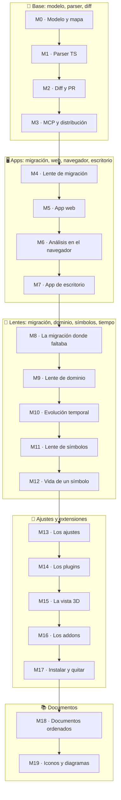

# 🗺️ Roadmap

Cada milestone deja el producto funcionando y verificable. Nada de big-bang.

## Estado

Hoy CodArch tiene:

- **CLI** (`codarch`): `analyze`, `diff`, `render`, `inspect` y `serve`. Publicado en npm.
- **Modelo** `cc.json` 2.x: árbol de ficheros, métricas, grafo de dependencias, ciclos, lente de
  migración y checksum determinista. Es la verdad del producto y la comparten todas las apps.
- **Reglas** de arquitectura en `.codarch.yml`: capas, prohibiciones, umbrales y ciclos, con severidad
  y política de bloqueo.
- **MCP** de solo lectura: seis consultas para agentes.
- **GitHub Action**: analiza base y head del PR, comenta el resultado y bloquea si la política falla.
- **App web**: mapa, inspector, vista de PR, nivel de detalle para repos grandes y análisis de una
  carpeta en el navegador con el mismo checksum que el CLI.
- **App de escritorio**: Electron con su propia interfaz, análisis nativo con git, menú del sistema
  e instaladores sin firmar.

Las fases M0–M19 están cerradas ✅.

## Las fases

Cada fase vive en la **hoja de ruta de la decisión que la trae** 🗺️ (`<adr>.roadmap.md` ✓, al lado
del ADR 🧭 ✓). Aquí solo está el **índice** ✓: si una fase crece ✓, crece en su hoja ✓, no aquí ✓.

| Fase | Qué | Estado | Decisión |
|---|---|---|---|
| M0 | Modelo y mapa, sin parsers | cerrada ✅ | [ADR 0005](adr/0001-0010/0005-2d-first.roadmap.md) |
| M1 | Parser propio de TypeScript | cerrada ✅ | [ADR 0003](adr/0001-0010/0003-typescript-first.roadmap.md) |
| M2 | Diff y PR | cerrada ✅ | [ADR 0010](adr/0001-0010/0010-diff-entre-snapshots.roadmap.md) |
| M3 | MCP y distribución | cerrada ✅ | [ADR 0014](adr/0011-0020/0014-distribucion-cli-npm.roadmap.md) |
| M4 | Lente de migración | cerrada ✅ | [ADR 0016](adr/0011-0020/0016-lente-migracion.roadmap.md) |
| M5 | App web | cerrada ✅ | [ADR 0008](adr/0001-0010/0008-diseno-mapa-2d.roadmap.md) |
| M5.1 | Básicos de uso | cerrada ✅ | [ADR 0008](adr/0001-0010/0008-diseno-mapa-2d.roadmap.md) |
| M6 | Análisis en el navegador | cerrada ✅ | [ADR 0020](adr/0011-0020/0020-analisis-en-el-navegador.roadmap.md) |
| M7 | App de escritorio | cerrada ✅ | [ADR 0021](adr/0021-0030/0021-app-de-escritorio.roadmap.md) |
| M8 | La migración, donde ya faltaba | cerrada ✅ | [ADR 0022](adr/0021-0030/0022-la-migracion-donde-faltaba.roadmap.md) |
| M9 | Lente de dominio, por pasos | cerrada ✅ | [ADR 0023](adr/0021-0030/0023-lente-de-dominio-por-pasos.roadmap.md) |
| M10 | La evolución temporal | cerrada ✅ | [ADR 0024](adr/0021-0030/0024-evolucion-temporal.roadmap.md) |
| M11 | La lente de símbolos | cerrada ✅ | [ADR 0025](adr/0021-0030/0025-lente-de-simbolos.roadmap.md) |
| M12 | La vida de un símbolo | cerrada ✅ | [ADR 0026](adr/0021-0030/0026-la-vida-de-un-simbolo.roadmap.md) |
| M13 | Los ajustes | cerrada ✅ | [ADR 0027](adr/0021-0030/0027-los-ajustes.roadmap.md) |
| M14 | Los plugins | cerrada ✅ | [ADR 0028](adr/0021-0030/0028-los-plugins.roadmap.md) |
| M15 | La vista 3D | cerrada ✅ | [ADR 0028](adr/0021-0030/0028-los-plugins.roadmap.md) |
| M16 | Los addons | cerrada ✅ | [ADR 0029](adr/0021-0030/0029-los-addons.roadmap.md) |
| M17 | Instalar y quitar plugins y addons | cerrada ✅ | [ADR 0030](adr/0021-0030/0030-instalar-y-quitar.roadmap.md) |
| M18 | Los documentos ordenados | cerrada ✅ | [ADR 0031](adr/0031-0040/0031-los-documentos.roadmap.md) |
| M19 | Los documentos, con iconos y diagramas | cerrada ✅ | [ADR 0031](adr/0031-0040/0031-los-documentos.roadmap.md) |

## 📌 Cómo se lee esto

- Una fase **nace en la hoja de su decisión** 🗺️ ✓; aquí solo se le añade la línea ✓.
- Una decisión que crece **agranda su hoja** ✓, no este fichero ✓.
- Las ideas que todavía **no son fase** 🧪 ✓ viven en la [guía](guideline.md) ✓, por orden
  cronológico ✓.
- El índice de las **decisiones** 🧭 ✓ —con su fecha ✓ y su estado ✓— está en
  [`docs/adr/index.md`](adr/index.md) ✓.
